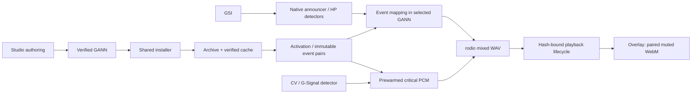

# GANN-only announcer event media contract

คำสั่งผู้ใช้วันที่ 2026-10-31 กำหนดให้เสียงและภาพของ announcer event มาจาก GANN เท่านั้น สัญญานี้แทน interface แบบ manifest/flat-cache ใน [[CR-009-gannstudio-authoring-install-contract]] โดยไม่เปลี่ยนกฎตรวจจับ event, Store entitlement, account หรือขอบเขตข้อมูลส่วนตัวของ [[mvp-decisions]]

## Package and playback

- `.gann` เป็น indexed ZIP รูปแบบ `g-ann-package` version 1 มี `gann.json`, registry `ann_<UUID>.json`, original/mixed WAV และ silent WebM ชื่อ ID ทุก payload มีขนาดและ SHA-256 ที่ตรวจสอบได้
- `registry.events[event]` เป็นรายการ `{sound_id,banner_id}` โดย banner อ้าง original และ playback sound ของคู่เดียวกัน ต้องผ่าน schema, reference, media-format และ hash admission ก่อนเล่น
- Studio สร้าง motion/ภาพให้เสร็จในขั้น authoring แล้วบรรจุลง GANN การกด Event Test ต้องอ่าน artifact นั้นด้วย reader เดียวกับ preview การ audition เสียงต้นฉบับระหว่างตัดต่อไม่ใช่ event playback
- Maiden อ่านและตรวจ GANN ตอน import/activation แล้วใช้ cache ที่ผูก pack/revision ใน runtime ไม่มีการแตก ZIP บน audio callback หรือ G-Signal hot path
- เสียง event ใช้ mixed WAV ของ mapping เท่านั้น; original ใช้ตรวจ identity ไม่มีการแทนด้วย original เมื่อ mixed เสีย ไม่มี default/flat-cache/embedded catalog/TTS หรือภาพ event ที่สร้างนอกแพ็กเป็น fallback
- วิดีโอถูกตรวจโครงสร้าง WebM และต้องมี video track ที่รองรับ ไม่มี audio track ตัว native player ยังต้อง decode จริง วิดีโอ muted เสมอและ rodio เป็นเจ้าของเสียง
- Missing/unmapped/invalid pair ต้องเงียบและบันทึกเหตุผล Session, pack revision, mute และ cancellation ต้อง fence เสียงและภาพที่เกี่ยวข้อง
- Dynamic advice ที่ไม่ได้เป็น announcer event แยกจาก resolver นี้ G-Signal detection/admission ยังคงเป็น Rust และไม่พึ่ง cloud, SLM หรือ WebView

## Event call graph

Unmapped/invalid mappings stop before audio admission; the overlay consumes the admitted pair's lifecycle and cannot independently select event media.

## Installation and activation

ดู [[gann-package-v1-local-authoring]] สำหรับ compression profile, portable project, named-pipe protocol, trust และ revision/installation ownership.

Maiden เป็น installer เพียงตัวเดียวใน production. Studio ส่ง local package request ผ่าน current-user/profile-bound named pipe พร้อม expected digest และ request ID. Maiden ตรวจ archive และ staged bytes ก่อน commit registry; install ไม่เท่ากับ equip. ไม่มีการแตกแพ็กผ่าน HTTP หรือ Studio direct-folder install.

Selection, inventory และ preview ใช้ opaque installation ID; announcer ID เป็น media identity แยกต่างหาก. Runtime ถือ immutable revision lease จนเสียงและ declared visual tail จบ; pending selection ใช้เมื่อไม่มี match/lease. Cache adoption ที่ล้มเหลวต้อง retry และ re-admit หลัง repair generation เปลี่ยน.

แพ็กโฟลเดอร์เดิมที่ไม่อยู่ใน registry ต้องนำ `.gann` เข้าอย่างชัดเจน ไม่อนุมาน System/Store authority และไม่กลับไปใช้ active-pack.txt เป็น production fallback. Local integrity ไม่เป็น Store receipt หรือ entitlement.

## Evidence boundaries

Package tests ตรวจ archive/schema/rollback; native injected-GSI ตรวจ production handler, audio admission และ WebView playback; live Dota, acoustic synchronization และ resource/FPS acceptance เป็นผลคนละประเภท ต้องรายงานแยกกัน ดูแผน [[2026-10-31-gann-only-events]] และผลทดสอบที่ผูกกับ source/binary ของ candidate ห้ามนำผลเก่าหรือ source checks ไปอ้างว่าผ่าน native/live qualification

## Changelog

| Version | Date | Change |
|---|---|---|
| 0.1.0 | 2026-10-31 | Owner-directed GANN-only creation, installation, activation and event media contract. |
| 0.2.0 | 2026-10-31 | Shared compression/profile, Maiden-owned registry/IPC install, installation identity and revision leases; link local creator contract. |
