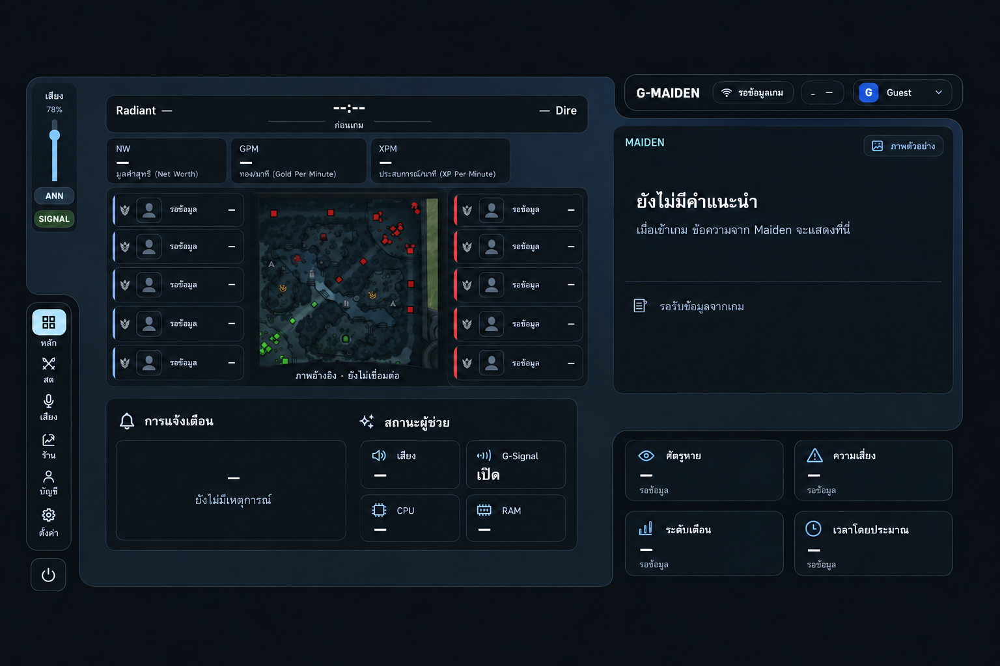

# Graphite Clarity — ปรับผิวและการอ่านข้อมูลบน layout เดิม

Owner เลือกภาพ Graphite Clarity ที่แก้ส่วนยื่นเหนือแถบเสียงแล้ว และสั่งให้เริ่มจาก design system ก่อนนำลงแอป เมื่อ 2026-10-12.
เอกสารนี้กำหนดงาน Command Deck เท่านั้น; เป็นการอนุมัติแบบ ไม่ใช่ผลทดสอบหรือสถานะ release.

ชุด wireframe ครบ 7 หน้าและ wireflow อยู่ที่ [[10-wireframes]] / [[11-wireflows]]. สองไฟล์นี้เป็น draft target ตามมติ MVP ปัจจุบัน; ไม่ทำให้พฤติกรรมที่ยังไม่ implement กลายเป็น shipped.

## 1. ลำดับแหล่งอ้างอิง

1. ตำแหน่งและรูปทรง: [[03-layout]] และ `FUNG_PANEL_PATH` / `FUNG_PANEL_PATH_SIGNALS` ใน `src/src/deck/prefs.ts`.
2. ผิว สี ลำดับข้อความ และ empty state: ภาพข้างต้น โดยใช้ token ใน [[02-tokens]].
3. ความหมายและพฤติกรรม: ข้อมูลจริงจาก existing builders, [[05-sitemap-ia]] และ [[04-components]].

ภาพเป็น visual reference ขนาด 1536×1024 ไม่ใช่พิกัด CSS: คง stage 1420×760 และ panel world 1280×720.
ภาพตกเมนู Insights ไปหนึ่งรายการ; implementation ต้องคงทั้ง 7 หน้าจาก `PAGES` พร้อม Ctrl+1..7.
รูป minimap และไอคอนใช้ asset เดิมของแอป ไม่สร้างข้อมูลเกมจากภาพตัวอย่าง.

## 2. Layout และขอบที่ต้องรักษา

- คง shell เว้า 3 จุด: topbar ขวาบน, navigation ซ้ายล่าง, signal cluster ขวาล่าง.
- คงตำแหน่ง score → stats → hero/map → alerts/state ทางซ้าย และ Maiden ทางขวา.
- คง bounding box ของ dashboard sectors, topbar, navigation, power และ signal cluster ตาม [[03-layout]].
- Audio rail ยึด stage x42/y40/w54; เพิ่มความสูงเป็น 198 เพื่อให้หัวข้อไทย ตัว slider และปุ่มไม่ทับกัน ภายในส่วนซ้ายบนของ shell.
- **ห้ามมี phase chip หรือ cap อยู่เหนือ rail**: phase อยู่ภายใน score header, ไม่มี negative top offset เหนือแถบเสียง.
- ไม่มี backdrop plate สี่เหลี่ยมลอดผ่านส่วนเว้า: support layer ต้องใช้ clip path เดียวกับ shell.
- คง stage scaling, big mode, compact density, quality tier, keyboard navigation และไม่มี page-level scroll.
- Tauri window นอก shell คงโปร่งใส; browser preview ใช้ `--g-void` เป็นฉากเพื่ออ่าน silhouette.

## 3. ผิวและการอ่าน

- Shell graphite สีน้ำเงินเทา; card ภายในทึบเข้ม ขอบบาง 1px อ่านแยกจาก shell ได้.
- Ice ใช้กับ focus, active navigation, slider และไอคอน; สีเตือนต้องมาจาก `sig.tone`.
- ไม่มี lime เต็มการ์ดเพียงเพราะเป็นการ์ด Gank Risk; unknown ใช้พื้น neutral.
- ใช้ bundled IBM Plex Sans Thai Looped / IBM Plex Mono ต่อไป ไม่มี CDN เพิ่ม.
- Navigation มีไอคอนพร้อมชื่อไทยสั้น: หลัก / สด / เสียง / ร้าน / สถิติ / บัญชี / ตั้งค่า.
- Stats ใช้ชื่อ NW/GPM/XPM พร้อมคำอธิบายไทย; จัด label/value ในแถวเดียวและคำอธิบายด้านล่างเพื่อให้พอดีช่อง 42px เดิม.
- Hero rows มี avatar, ชื่อ/สถานะ, KDA และขอบทีม; ไม่ใส่ rank หรือข้อมูลคู่แข่งที่แอปไม่มี.
- Alert log และ utterance log ใช้การเลื่อนภายในเมื่อยาว ไม่ขยายกล่องไปทับโซนอื่น.

## 4. State contract

| ส่วน | ไม่มีข้อมูล | เมื่อมีข้อมูล |
| --- | --- | --- |
| Score / clock / NW / GPM / XPM | `—` / `--:--` เมื่อ GSI offline หรือยังไม่มี tick; ไม่ใช้ fallback 0 เป็นค่าจริง | แสดงข้อมูลจาก match builder; 0 ที่ได้รับจริงยังแสดง 0 |
| Phase | ก่อนเกม / เตรียมเกม / กำลังเล่น / จบเกม ใน score header | ใช้ matchPhase เดิม ไม่เปลี่ยนเพราะกด preview |
| Hero/map | สถานะ `รอข้อมูล`; map badge `ภาพอ้างอิง · ยังไม่เชื่อมต่อ` | ใช้ portrait/roster/minimap-frame จริงตาม flow เดิม |
| Maiden | หัวข้อ `ยังไม่มีคำแนะนำ`, คำอธิบาย และ `รอรับข้อมูลจากเกม` | utterance ล่าสุดเด่น, ประวัติด้านล่าง, belief revision ขีดฆ่าข้อความเดิม |
| Provider chip | ซ่อนเมื่อยังไม่มี MASTER response ที่ระบุ provider | `ollama` → LOCAL SLM; `claude` → CLOUD; ค่าว่าง/unknown ไม่เดา |
| Alert log | `ยังไม่มีเหตุการณ์` | activity จริงใน bounded list |
| Signal cards | `—` และ `รอข้อมูล`, ไม่แสดง empty meter เป็น safe | ใช้ value/tone/barPct จาก `buildSignals` โดยไม่คำนวณความเสี่ยงใหม่ใน UI |
| Voice / CPU / RAM | `—` เมื่อไม่มี pack/sensor | ค่าเดิมจาก backend; Signal on/off ใช้ preference ที่ผู้ใช้เลือก |

Standby/prep readiness rundown และ debrief timeline ยังคงอยู่ใน battle seat เดิม.
ปุ่มดูหน้าจอสดใช้ preview ของ layout เท่านั้น ไม่เปลี่ยน GSI, phase, status หรือสร้าง match data.
ภาพ badge `ภาพตัวอย่าง` ไม่ใช่คำสั่งใหม่ในแอป; ใช้ปุ่ม preview ที่มีอยู่ใน readiness flow.

## 5. Acceptance

- เปรียบเทียบภาพกับ browser-rendered deck ที่ viewport 1536×1024 และ state offline + live-layout preview.
- ตรวจ 1440×900, 1200×780 และ 1920×1080 รวม compact/eco ว่า controls อยู่ใน viewport และไม่มี element ยื่นเหนือ audio rail.
- ตรวจ nav ทั้ง 7, shortcuts, volume, ANN/SIGNAL, profile menu, power menu และ readiness/live preview.
- ตรวจข้อมูลยาว, unknown signals, danger และ belief revision จาก fixture ที่ระบุชัดว่าเป็นข้อมูลทดสอบ; ไม่อ้างว่าเป็น live Dota evidence.
- Frontend: ESLint, TypeScript, Vitest, production build. Repository gate: doc-graph, Rust tests, clippy และ Tauri smoke `--no-bundle`.
- Browser QA ไม่ใช่หลักฐาน native drag/click-through, GSI/CV/audio E2E หรือ NFR/FPS; บันทึกส่วนที่ยังไม่ได้วัดตามจริง.

## Changelog
| Version | Date | Summary |
| --- | --- | --- |
| 1.0.0 | 2026-10-12 | Owner selected corrected Graphite Clarity; lock shell/layout, define readable states and audio containment before implementation. |
| 1.0.1 | 2026-10-12 | Link complete seven-page wireframe/wireflow package and distinguish draft target behavior from shipped evidence. |
| 1.0.2 | 2026-10-16 | Remove retired local review integration and related dependencies. |
