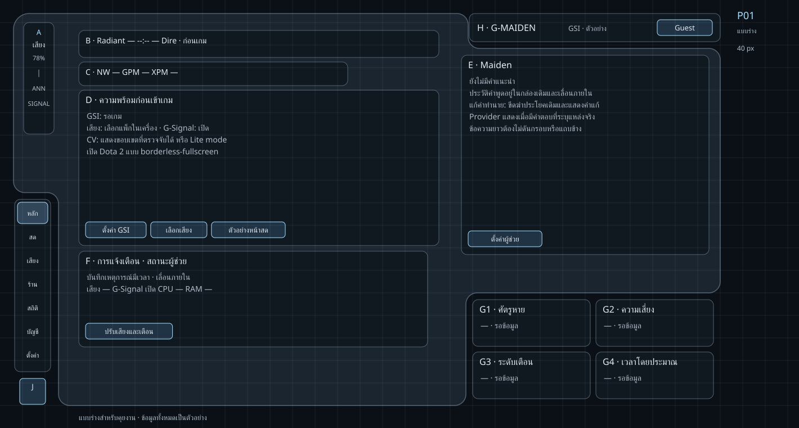
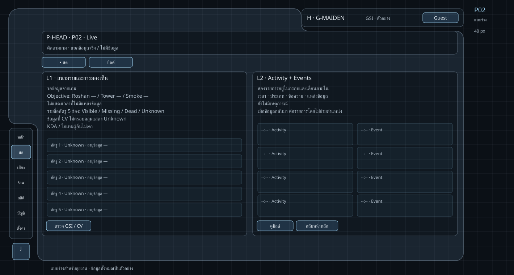
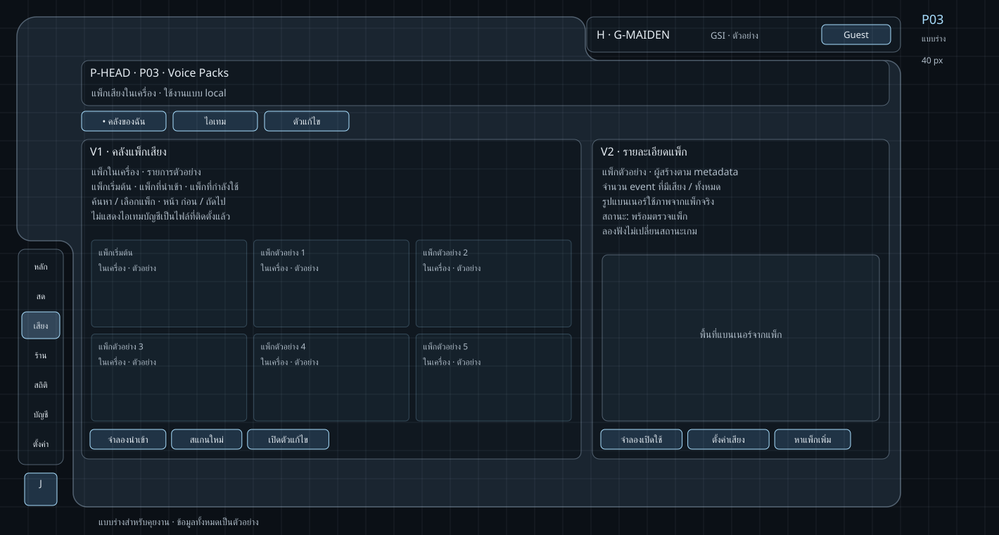
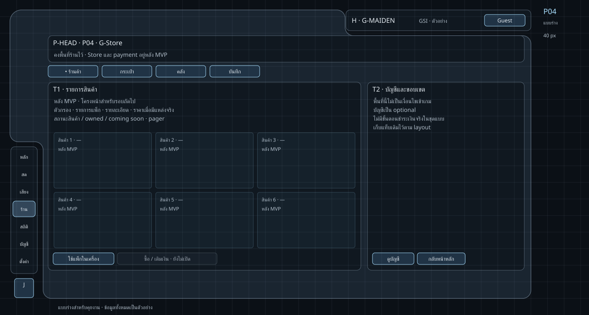
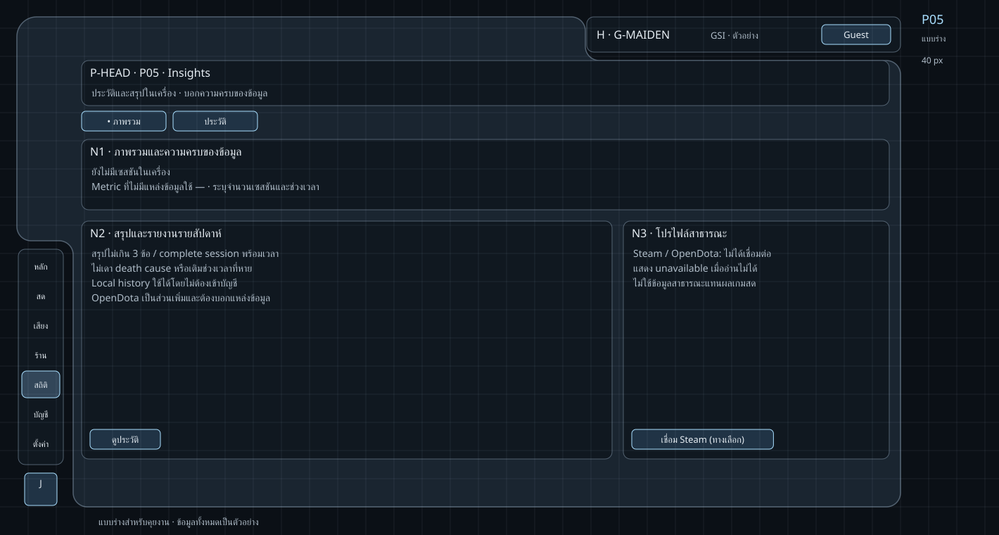
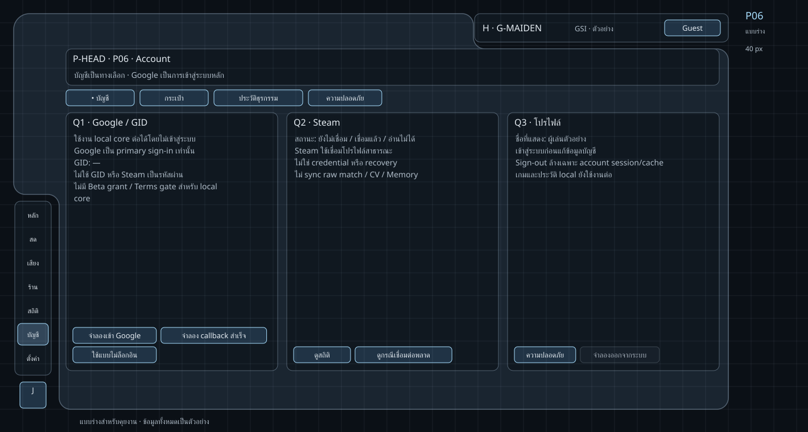
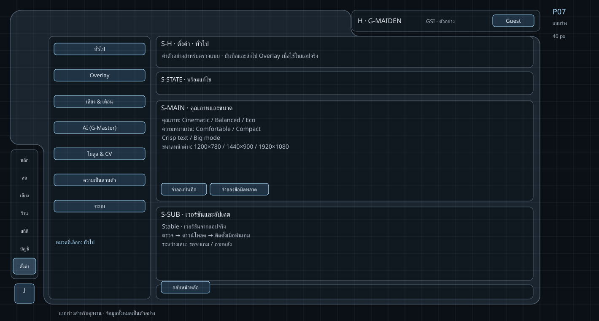

# Wireframe ครบ 7 หน้า — ใช้กริดและกรอบเดิม

Owner สั่งให้ใช้กริดที่ตรวจร่วมกันเป็นฐาน ทำครบ 7 หน้าและเชื่อม wireflow เมื่อ 2026-10-12.
ชุดนี้เป็น **แบบร่างสำหรับตรวจและพัฒนาต่อ** ไม่ใช่หลักฐานว่าพฤติกรรมทุกข้อส่งมอบในแอปแล้ว.
คง shell/layout ตาม [[03-layout]] และ art direction [[09-graphite-clarity]].
ใช้ product target จาก [[mvp-decisions]]: local-first, account optional, cloud context ปิดเริ่มต้น; Store/payment อยู่หลัง MVP.

**เปิดแบบที่กดได้:** [Wireframe / Wireflow viewer](assets/wireframes/index.html).
เลือกหน้า, แท็บ/หมวด, สถานะ, เปิด–ปิดกริด, กด CTA ข้ามหน้า และย้อนกลับได้.
สถานะทุกจุดเป็นตัวอย่าง; viewer ไม่เรียก Tauri, OAuth, network, file picker, เสียง หรือการชำระเงิน.
ปุ่มซื้อ/เติมเงินเป็น disabled พร้อมเหตุผล; ไม่จำลองว่าธุรกรรมสำเร็จ.

## 1. ขอบเขตความครบ

| Page ID | หน้า / route | แท็บหรือหมวดที่มี wireframe | จำนวน |
| --- | --- | --- | --- |
| P01 | หลัก / `dashboard` | ภาพรวม + standby/prep/live/debrief/stale | 1 |
| P02 | สด / `live` | สด, บิลด์ | 2 |
| P03 | เสียง / `voice` | คลังของฉัน, ไอเทม, ตัวแก้ไข | 3 |
| P04 | ร้าน / `store` | ร้านค้า, กระเป๋า, คลัง, บันทึก | 4 |
| P05 | สถิติ / `insights` | ภาพรวม, ประวัติ | 2 |
| P06 | บัญชี / `account` | บัญชี, กระเป๋า, ประวัติธุรกรรม, ความปลอดภัย | 4 |
| P07 | ตั้งค่า / `settings` | ทั่วไป, Overlay, เสียง & เตือน, AI, โมดูล & CV, ความเป็นส่วนตัว, ระบบ | 7 |
| รวม | 7 หน้า | 23 กรอบแท็บ/หมวด, 88 page/tab/state combinations ใน viewer | 23 |

88 combinations รวมการใช้สถานะร่วมข้ามแท็บ ไม่ใช่ 88 หน้าหรือ 88 พฤติกรรมใหม่.
แท็บ economy ใน Account และ Voice ยังแสดง deferred แม้เลือกสถานะบัญชี/แพ็กอื่น.
รายละเอียด transition และผลสำเร็จ/ล้มเหลว/ยกเลิกอยู่ใน [[11-wireflows]].
โครง Wireframe ครอบคลุม desktop Control; Overlay เป็นปลายทาง preview/setting ตาม [[07-combat-hud]] ไม่เพิ่มเป็นหน้า nav ที่ 8.

## 2. Geometry และรหัสสำหรับคุยงาน

- หน่วยพิกัดทั้งหมดเป็น **stage-space px**: 1420×760; panel-local 1280×720 อยู่ที่ stage (12,12).
- รหัสโซน A–J เป็นชุดอ้างอิงในการคุยงานนี้ ไม่ใช้สลับกับรหัส layer ของภาพ debug รุ่นเก่า.
- กริดหลัก 40 px ใช้วัด/สื่อสาร; ใช้ระยะย่อยตาม token เดิมได้ ไม่บังคับย้ายทุกขอบให้ลงเส้นกริด.
- ไม่ย่อ/ขยายกล่องแต่ละใบอิสระตาม viewport; ย่อ stage ทั้งชุดตาม [[03-layout]].
- Dashboard ใช้ `FUNG_PANEL_PATH_SIGNALS` (เว้า 3 จุด); หน้าอื่นใช้ `FUNG_PANEL_PATH` (ไม่มี signal notch ขวาล่าง) ตามแอปเดิม.
- H/I/J เป็น stage siblings; A/G แสดงเฉพาะ Dashboard. เนื้อหาอื่นอยู่ภายใน shell และไม่ทำ page-level scroll.

| Zone | เนื้อหา Dashboard | x | y | w | h |
| --- | --- | --- | --- | --- | --- |
| A | เสียง / volume / ANN / SIGNAL | 42 | 40 | 54 | 198 |
| B | คะแนน / เวลา / phase | 140 | 54 | 640 | 48 |
| C | NW / GPM / XPM | 140 | 110 | 478 | 42 |
| D | Readiness / battle / debrief | 140 | 160 | 640 | 276 |
| E | Maiden / utterance ledger | 820 | 98 | 440 | 354 |
| F | Alerts / companion status | 140 | 446 | 620 | 170 |
| G | Signal 2×2 | 840 | 532 | 428 | 176 |
| H | Topbar / GSI / profile | 834 | 24 | 446 | 50 |
| I | เมนู 7 หน้า | 26 | 354 | 64 | 306 |
| J | Power main button (ปิดเมนู) | 35 | 672 | 46 | 46 |

B–F แปลงจากตาราง panel-local ใน [[03-layout]] โดยบวก (12,12) แล้ว จึงห้ามบวกซ้ำ.
G แยกเป็น G1–G4 ขนาด 209×83, gap 10; ไม่ใช่กล่องใหม่เพิ่มจาก layout.
Power expanded bounds เดิม 190×46 ใช้รายละเอียด [[03-layout]]; viewer แสดง intent ใน dialog เพื่อไม่สั่งปิดโปรแกรมจริง.

หน้า P02–P06 ใช้ content envelope เดิม **(116,86,1148,622)**: header, tabs, bounded body.
P07 คง split view: categories (116,86,240,622), gap 14, detail (370,86,894,622).
สัดส่วนการ์ดด้านในหน้าอื่นเป็น wireframe ภายใน envelope นี้ ต้องตรวจและทำ implementation ต่อ; ไม่มีการอ้างว่าแต่ละการ์ดตรง runtime ทุก px.
ชื่อแบบ/เลขหน้า/คำว่า “ข้อมูลตัวอย่าง” ในขอบนอกเป็น annotation ของเอกสาร ไม่เพิ่มลง product chrome.

## 3. P01 — หลัก



อ่านจาก B คะแนน/เวลา → C สถิติ → D readiness/battle → E Maiden → F/G สถานะ.
เสียง A อยู่ด้านใน shell ไม่มี cap หรือ phase chip ทะลุเหนือขอบ; phase อยู่ B.

| State | D / ข้อมูลหลัก | การกระทำและปลายทาง |
| --- | --- | --- |
| standby | checklist GSI, voice, Signal, CV; ไม่มีบัญชีก็เข้าได้ | D-SETUP → P07 ระบบ; D-VOICE → P03 คลัง |
| prep | draft / hero select / loading; checklist คงที่ | เลือกเสียง / แก้ GSI ได้โดยไม่ย้ายกล่อง |
| live | hero columns + minimap; ไม่เดาข้อมูลผู้เล่นอื่น | D-LIVE → P02 สด |
| debrief | timeline ล่าสุด; sticky จนมี phase ใหม่หรือผู้ใช้กลับ | D-HISTORY → P05 ประวัติ; D-RESET → standby |
| stale | ค่าไม่สดใหม่/Unknown; ไม่ใช้ empty เป็น safe | ตรวจ GSI → P07 ระบบ; valid tick ใหม่คืน phase ตามจริง |

E-AI → P07 AI; F-ALERTS → P07 เสียง & เตือน. ข้อความ/ประวัติยาวเลื่อนภายใน E/F.
ปุ่ม “ตัวอย่างหน้าสด” ใน **viewer** เลือกภาพสถานะ live; ในแอปจริง preview เป็น local layout preview ที่ไม่เปลี่ยน GSI/phase/data.
สัญญาณ danger และ belief revision ต้องใช้ semantic token และพฤติกรรมใน [[04-components]], [[09-graphite-clarity]].

## 4. P02 — สด



คง tabs `[สด | บิลด์]`, hero/status summary ด้านบน, สองคอลัมน์เนื้อหา.

| Tab | เนื้อหาหลัก | Empty / unavailable | CTA |
| --- | --- | --- | --- |
| สด | Objective/visibility ซ้าย; Activity + Events ขวา | Objective ที่ไม่มี source = —; ไม่มี tick = รอข้อมูล; stale แยกค่าล่าสุด | L-SETUP → P07 โมดูล & CV; L-BUILD → บิลด์; L-HOME → P01 |
| บิลด์ | own-player items ซ้าย; คำแนะนำ Maiden ขวา | ไม่เดา lane/next item; deep Coach หลัง MVP | B-LIVE → สด; B-AI → P07 AI |

Live/stale/waiting เปลี่ยนข้อมูลในกล่องเดิม; feed scroll มีขอบเขต. ไม่แสดง objective timing สมมติ.
[Wireframe บิลด์](assets/wireframes/P02-live-build.svg)

## 5. P03 — เสียง



คง split inventory/detail, tab bar 3 รายการและทางไป Store; แพ็กในเครื่องใช้งาน local.

| Tab | เนื้อหา / state | CTA / ผลลัพธ์ |
| --- | --- | --- |
| คลังของฉัน | รายการแพ็กซ้าย / detail+coverage+active ขวา; ready/empty/loading/error/active | V-IMPORT → อ่านและ validate; V-EQUIP → active; V-RETRY → rescan; V-AUDIO → P07 เสียง |
| ไอเทม | สิทธิ์ไอเทมบัญชี แยกจากไฟล์ที่ติดตั้ง; หลัง MVP | V-LOCAL → คลังในเครื่อง; V-STORE → P04 คลัง |
| ตัวแก้ไข | event mapping ซ้าย / clip detail ขวา; default pack อ่านอย่างเดียว | V-SAVE → saved; V-CANCEL → คลัง; V-ERROR → กรณีบันทึกพลาด |

นำเข้าไฟล์ไม่รองรับ/ติดตั้งพลาดต้องคงแพ็กเดิม; ไม่ตีความ metadata ผู้สร้างว่า verified identity.
ลองฟังไม่เปลี่ยนเกม. งานแก้ไขค้างก่อนออกมี Save / Discard / Stay; viewer อธิบาย contract โดยไม่แก้ไฟล์จริง.
V-MORE → P04 ร้านค้า และมีทางกลับคลังเสมอ.
[ไอเทม](assets/wireframes/P03-voice-items.svg) · [ตัวแก้ไข](assets/wireframes/P03-voice-editor.svg)

## 6. P04 — ร้าน



คงหน้าและ 4 tabs ตาม nav เดิม; ทุกแท็บติด **หลัง MVP** ตามมติ ไม่ทำให้ผู้ใช้เข้าใจว่าซื้อได้แล้ว.

| Tab | พื้นที่ที่เตรียมไว้ | ขอบเขต |
| --- | --- | --- |
| ร้านค้า | ตัวกรอง / catalog / detail / pager | ราคา/stock ใช้ — จนมี source; ปุ่มซื้อ disabled |
| กระเป๋า | balance / transaction preview | ไม่สร้างยอดหรือเปิด top-up |
| คลัง | entitlement / installed / active | ไม่รวมกับแพ็ก local จนมีหลักฐานติดตั้ง |
| บันทึก | ประเภท / วันที่ / จำนวน / status / receipt | ไม่ใช้ธุรกรรมสมมติเป็นผลเงินจริง |

T-VOICE → P03 local packs; T-ACCOUNT → P06 optional account; T-HOME → P01.
ไม่มี payment/receipt/terms consent ใหม่ในชุดแบบ; account services ที่มีอยู่ยังต้องตรวจสิทธิ์ของตน.
[กระเป๋า](assets/wireframes/P04-store-wallet.svg) · [คลัง](assets/wireframes/P04-store-inventory.svg) · [บันทึก](assets/wireframes/P04-store-ledger.svg)

## 7. P05 — สถิติ



| Tab | เนื้อหา | State / recovery |
| --- | --- | --- |
| ภาพรวม | metric พร้อม source/coverage, weekly/local summary, optional public profile | ไม่มีข้อมูล = —; local history ไม่รอ sign-in; OpenDota unavailable ไม่เท่ากับ 0 |
| ประวัติ | รายการเซสชันซ้าย / detail+timeline ขวา; paginate ภายใน | empty/loading/error/complete/partial; partial ไม่เดาแพ้ชนะ/death cause |

N-HISTORY → ประวัติ, N-OVERVIEW → ภาพรวม, N-ACCOUNT → P06 Steam, N-SYSTEM → P07 ระบบ.
Summary เป้าหมายไม่เกิน 3 ข้อ พร้อม event/timestamp ต่อ complete session ตาม [[mvp-decisions]].
Pane รายละเอียดและการจำรายการที่เลือกเป็น target UX เพิ่มเติม ต้องพัฒนาแยกจากรายการ history ปัจจุบัน.
[ประวัติและรายละเอียด](assets/wireframes/P05-insights-history.svg)

## 8. P06 — บัญชี



คง 3 cards Google/GID, Steam, Profile และ 4 tabs; ไม่มี mandatory Closed Beta handoff บน local core.

| Tab / state | พฤติกรรม |
| --- | --- |
| บัญชี / signedout | อธิบายว่า optional; Q-GOOGLE → OAuth; Q-LOCAL → local dashboard |
| loading | รอ browser callback; ยกเลิกหรือ timeout → error/signedout; ไม่เดา GID |
| signedin | GID จาก server; editable display name; save progress/success/error; Steam เป็น link เพิ่มเติม |
| error / expired | retry หรือ local ต่อ; protected account actions unavailable จนยืนยันใหม่ |
| กระเป๋า / ประวัติธุรกรรม | ใช้ขอบเขต deferred แบบ P04 ไม่เปิดธุรกรรม |
| ความปลอดภัย | server-backed current session/devices/activity; unreadable = unavailable; action อาจต้อง step-up |

Q-OUT/sign-out/revoke/account switch ล้าง account session/cache และ invalidate request ของบัญชีเก่า; local gameplay/log/history ไม่ถูก lock.
ไม่เพิ่ม GID/password login, MFA enrollment, recovery, public profile/badge หรือการเก็บข้อมูล private ใหม่.
อ่าน flow target นี้ร่วม [[mvp-decisions]]; ส่วน Closed Beta ใน [[08-account-gid]] เป็น legacy distribution context ไม่ใช่ entrance flow ปัจจุบัน.
[กระเป๋า](assets/wireframes/P06-account-wallet.svg) · [ธุรกรรม](assets/wireframes/P06-account-ledger.svg) · [ความปลอดภัย](assets/wireframes/P06-account-security.svg)

## 9. P07 — ตั้งค่า



คง category rail 240px และ detail pane 894px ใน envelope เดิม. Header/status/action row อยู่กับที่; เฉพาะ detail body เลื่อนได้เมื่อเนื้อหาเกิน.

| หมวด | เนื้อหาครบในแบบ | การเชื่อม |
| --- | --- | --- |
| ทั่วไป | quality, density, crisp, big mode, presets, version, stable update | checking/downloading/ready/error; install เมื่อพ้นเกม |
| Overlay | on/off, modules, layout/scale/profile, preview, save/cancel | preview ไม่แตะ GSI; ปิด preview คืนค่าที่บันทึก |
| เสียง & เตือน | voice, volume/rate, sensitivity, banner test, persona, ANN/Signal | S-VOICE → P03; PTT เป็น target MVP ไม่อ้างว่าพร้อมแล้ว |
| AI | provider/model/readiness, cloud context opt-in แยก, local fallback | S-PRIVACY → privacy; consent off → ไม่ส่ง game context |
| โมดูล & CV | modules, DXGI, coverage/Lite, calibration/telemetry source | failure → GSI-only; empty ≠ safe |
| ความเป็นส่วนตัว | local data/storage, retention/delete scope, cloud context boundary | S-AI → AI; delete มี confirm/cancel/error |
| ระบบ | Dota path, GSI cfg install/status/freshness, log folder, diagnostics/changelog | S-GSI → pending/success/error; S-HOME → P01 |

ทุกหมวดมี ready/saving/saved/error ใน viewer. เมื่อทำรายการล้มเหลวคงค่าที่ใช้ได้เดิม; retry ไม่ทำรายการซ้ำระหว่าง pending.
การลบข้อมูล/ติดตั้ง update/เปลี่ยน provider ในแอปจริงยังต้องใช้ contract ที่เกี่ยวข้อง ไม่ใช้ viewer เป็นการอนุมัติ side effect.
[Overlay](assets/wireframes/P07-settings-overlay.svg) · [เสียง](assets/wireframes/P07-settings-voice.svg) · [AI](assets/wireframes/P07-settings-ai.svg) · [CV](assets/wireframes/P07-settings-modules.svg) · [Privacy](assets/wireframes/P07-settings-privacy.svg) · [ระบบ](assets/wireframes/P07-settings-system.svg)

## 10. ระดับความตรงกับ implementation

| ขอบเขต | หลักฐาน / สิ่งที่ยังต้องทำ |
| --- | --- |
| Stage, shell paths, H/I/J, Dashboard A–G | อ้าง `src/src/deck/prefs.ts`, `src/src/styles.css`, [[03-layout]]; generator ตรวจสอง path ตรง runtime |
| 7 nav + tabs/categories | โครง rail และหน้าหลักมีใน `CommandDeck.tsx` / `deck/nav.ts`; target 23 views / 88 states ไม่ได้แปลว่า source ครอบคลุมทุก state |
| MVP access/cloud/history/update target | อ้าง [[mvp-decisions]]; route-level source crosswalk UF01–UF08 อยู่ใน [[mvp-backlog]]; ไม่รับรอง runtime/provider acceptance |
| Dashboard cross-page CTA, history detail, Voice mapping editor + unsaved guard | เป็น target เพิ่มเติม; current history เป็น list/pagination และ VoicePacksPage มี inventory/items โดยไม่พบ editor route |
| Store/payment/security expansion | commerce expansion ยัง deferred; current Store/Wallet UI มี purchase/top-up และ user-triggered match-share call paths. Faucet ส่ง match ID ให้ function ตรวจ OpenDota และเก็บ HMAC ref ไม่ใช่ raw G-Log; provider settlement/acceptance ยังไม่ยืนยัน. เอกสาร target ไม่อนุมัติการเปิดขายหรือแก้ provider/RLS/migration/egress |
| Settings / consent / update guard | settings ปัจจุบัน auto-save; cloud-context consent flow และการเลื่อน updater จนพ้นเกมยังเป็น target ไม่ใช่ behavior ที่ source ยืนยัน |
| Viewer controls | เปลี่ยน route/state ของแบบเท่านั้น ไม่บันทึกค่าผู้ใช้ลงแอป |

## 11. สร้างภาพและตรวจรับ

รันจาก repo root:

```sh
node docs/design-system/assets/wireframes/build.mjs
```

ตรวจ exact shell paths, stage bounds, reserved text space และ CTA destinations ทั้ง 88 combinations.
สร้าง SVG 23 แท็บ/หมวด + 8 wireflows และ [manifest](assets/wireframes/manifest.json) จาก model เดียวกับ viewer.
การตรวจนี้พิสูจน์แบบและลิงก์ ไม่แทน browser visual QA, native E2E หรือ performance.
ผล browser review/ข้อจำกัดบันทึกใน [design QA](assets/wireframes/design-qa.md).
เมื่อแก้ model/renderer ให้ regenerate ภาพก่อนรัน doc-graph gate.

## Changelog

| Version | Date | Summary |
| --- | --- | --- |
| 1.0.0 | 2026-10-12 | Wireframe 7 pages / 23 tabs and categories with state coverage, preserved shell/grid, source map, and linked viewer/wireflows. |
| 1.0.1 | 2026-10-19 | เพิ่มขอบเขต target-vs-source สำหรับ voice editor, history, store/match-share side effects, settings consent และ update guard พร้อมลิงก์ crosswalk |
