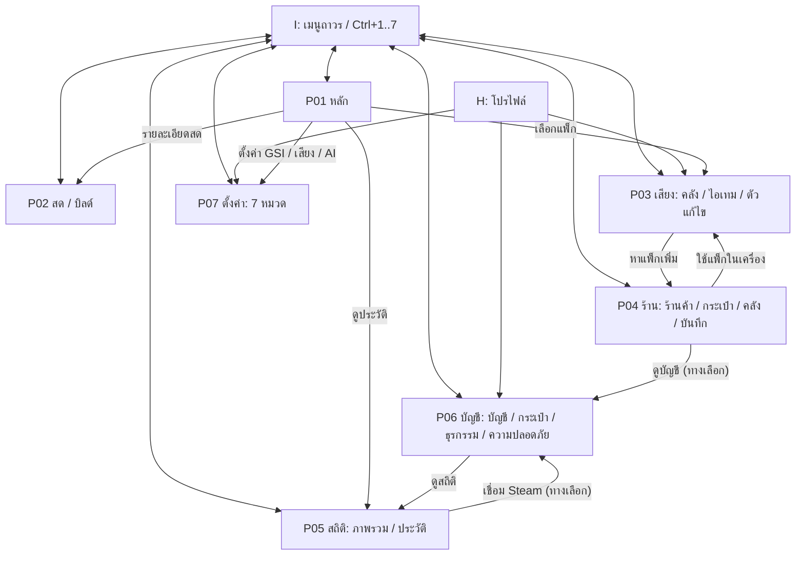
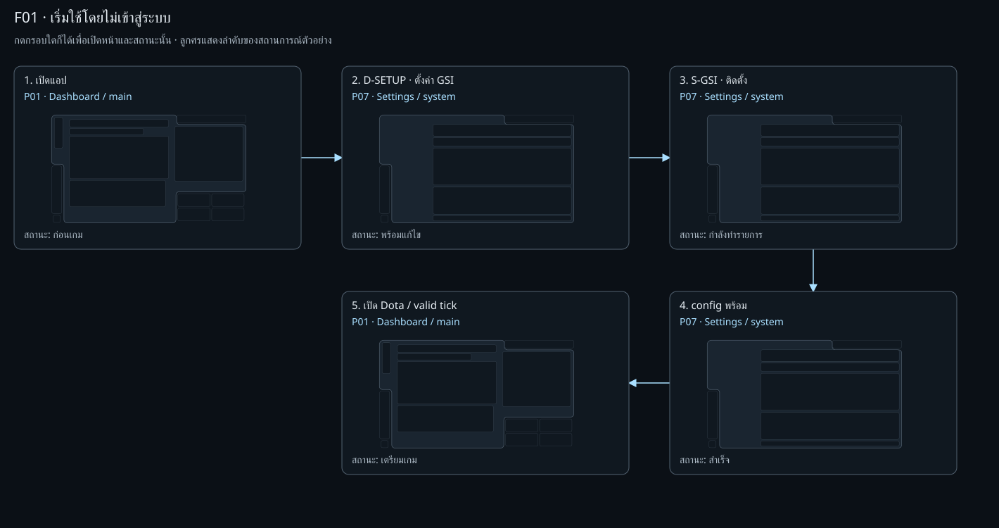
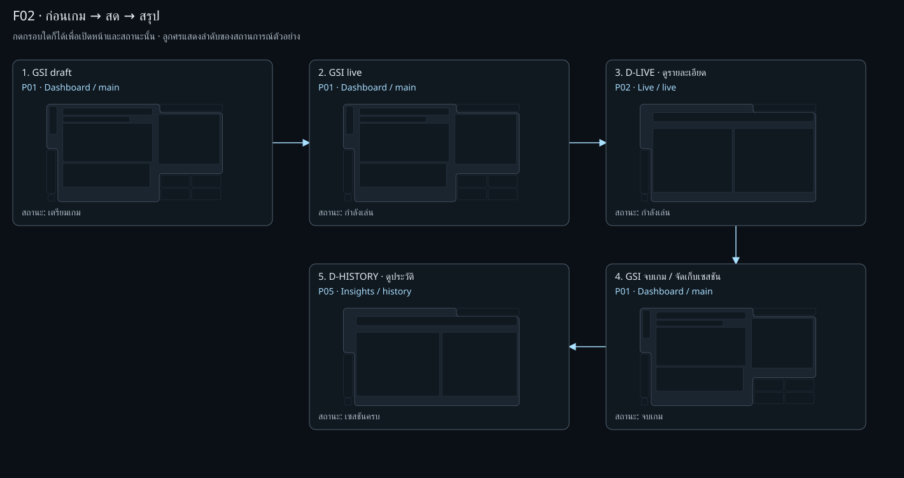
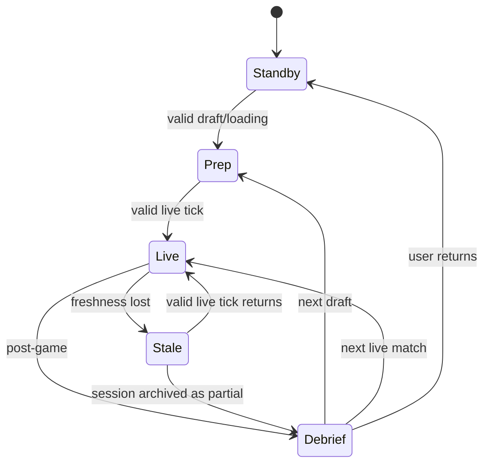
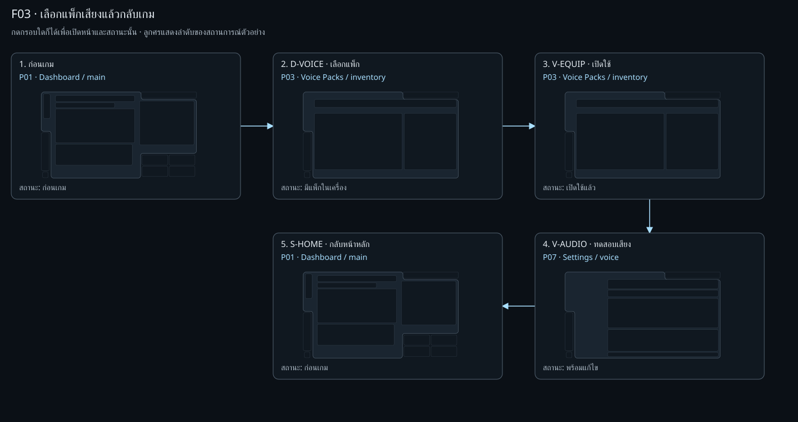
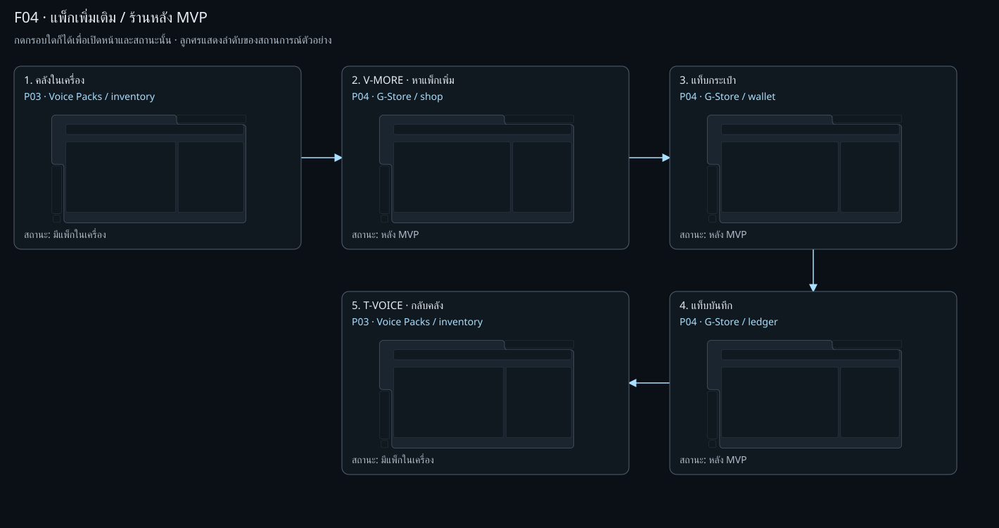
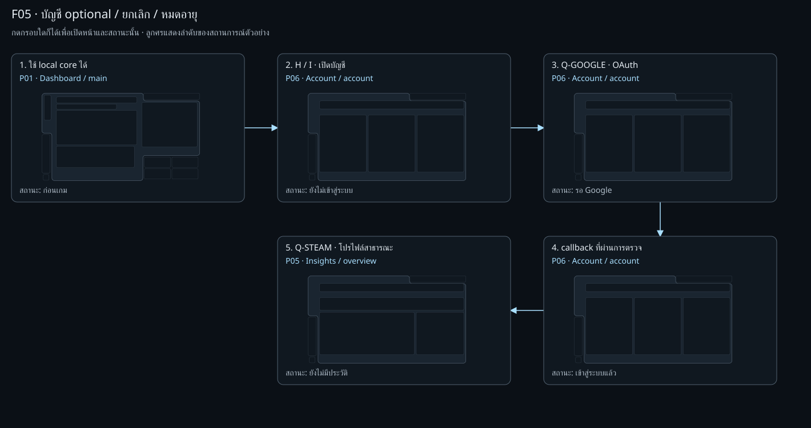
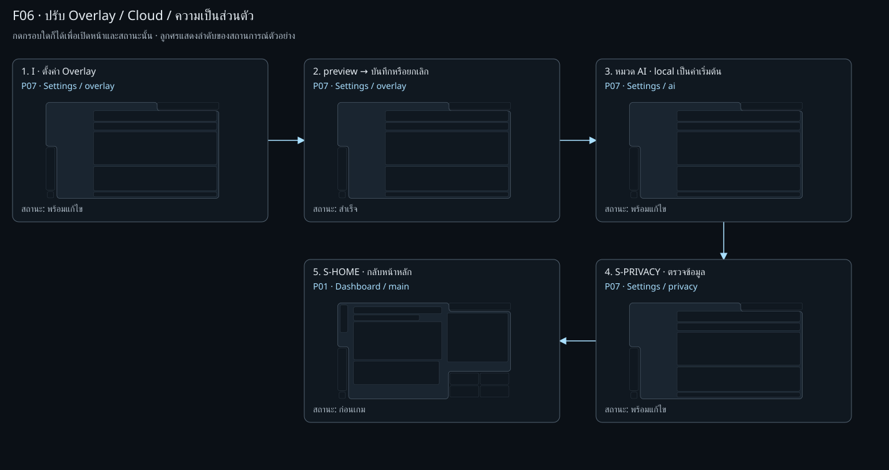
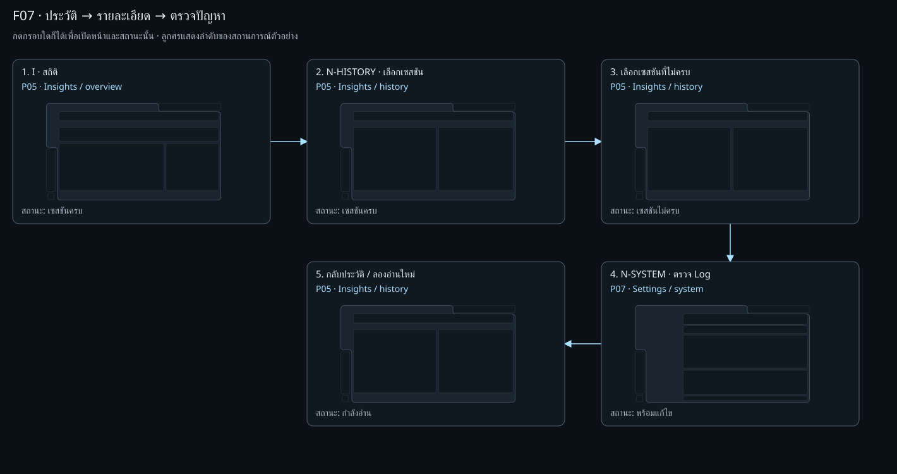
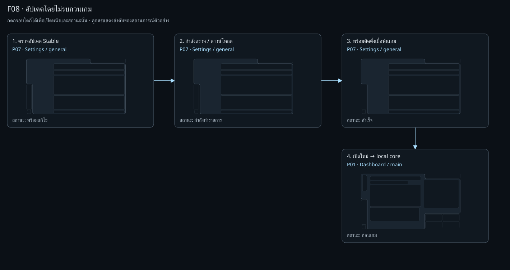

# Wireflow — เชื่อมครบ 7 หน้า

อ้าง screen IDs และ geometry ใน [[10-wireframes]]. เป็น target UX สำหรับตรวจแบบและนำไปพัฒนาต่อ;
ไม่ใช่คำกล่าวว่า backend ทุกเส้นทางพร้อมแล้ว. ดู [viewer ที่กดข้ามกรอบได้](assets/wireframes/index.html), เปลี่ยนเป็น **Wireflow**.
แต่ละลูกศรระบุ trigger; ทุก scenario มี error/cancel/return route.
เป้าหมายผู้ใช้ จุดตัดสินใจ และผลลัพธ์ของแต่ละเส้นทางแยกไว้ใน [[12-user-flows]]; ใน viewer เลือก **User Flow**.

## 1. กติกานำทางร่วม

- I อยู่ตำแหน่งเดิมทุกหน้า. เปลี่ยนหน้าไม่เปลี่ยนเกม/phase/บัญชี/provider.
- H เปิด popover โปรไฟล์; เลือกปลายทางแล้วปิด. Escape/กดนอก/ปิด → คืน focus ให้ H.
- แท็บ/หมวดเปลี่ยนเฉพาะ bounded content; ความสูง stage และกรอบเว้าไม่เปลี่ยน.
- Context CTA ระบุแท็บปลายทางตรง เช่น GSI → P07/system, log → P05/history; ไม่บังคับเริ่มที่แท็บแรก.
- เมื่อกลับจากการแก้ปัญหาให้คืนจุดเดิมและรายการที่เลือก; ถ้าข้อมูลถูกลบให้แสดง empty พร้อมเหตุผล.
- งานแก้ไขค้าง: Save / Discard / Stay; pending ที่ยกเลิกไม่ได้บอกสถานะและห้ามส่งซ้ำ.
- ปุ่มย้อนกลับใน viewer ใช้ประวัติของแบบเอง; ไม่เสนอเพิ่มปุ่ม Back ถาวรใน product chrome.
- UI หน้าไม่บังคำเตือนเกม; core G-Signal/เสียงยังใช้ Rust path เดิม.

## 2. F01 — เริ่มใช้ local / ติดตั้ง GSI

Launch → P01/standby → D-SETUP → P07/system → ตรวจ path/ติดตั้ง cfg → เปิด Dota → valid GSI → P01/prep/live.

| Branch | ผล / ปลายทาง |
| --- | --- |
| cold offline / signedout | เข้า local setup ได้; account/cloud unavailable ตามจริง |
| ไม่พบ Dota / permission denied | P07/system/error ระบุสาเหตุและวิธีแก้; retry อยู่กรอบเดิม |
| ยกเลิก setup | กลับ P01/standby; checklist ยังคงไม่พร้อม |
| cfg พร้อมแต่ไม่มี tick | รอเกม ไม่แสดง LIVE จากความสำเร็จของ installer |
| Capture ใช้ไม่ได้ / geometry ไม่รองรับ | GSI-only Lite mode; แสดง CV coverage ไม่รับรอง safe |

ไม่ใช้ Google, GID, grant หรือ Beta Terms เป็นเงื่อนไขเข้า local core ตาม [[mvp-decisions]].

## 3. F02 — Phase / ข้อมูลสด / จบเกม

GSI prep → live เปลี่ยนเฉพาะ D/B. D-LIVE → P02/live; tab Build ไม่สร้าง match state ใหม่.
G-Signal danger → banner + priority voice ใน Overlay; belief revision แก้ข้อความ/เสียงตาม [[07-combat-hud]].
Post-game → P01/debrief → D-HISTORY → P05/history.

`stale` เป็น **presentation/freshness overlay** ในแบบ ไม่เพิ่ม `MatchPhase` enum ฝั่ง runtime.
Phase builder ปัจจุบันยังเป็น standby/prep/live/debrief; การ disconnect/archive ต้องแยก partial ตาม contract ก่อนรับ implementation.
ไม่ให้การสลับ nav, เปิด preview หรือไม่มี CV ถูกตีความว่าเกมเริ่ม/จบหรือไม่มีภัย.
Debrief sticky ผ่าน Dota ปิด; เซสชันไม่ครบแสดงข้อจำกัดและไม่เดาผล.

## 4. F03 — แพ็กเสียง / ลองฟัง / บันทึก

P01 D-VOICE → P03/inventory → เลือกแพ็ก → validate → V-EQUIP → active → V-AUDIO → P07/voice → กลับหน้าเดิม.

| Trigger | Pending / success | Failure / cancel |
| --- | --- | --- |
| Import | เปิด file picker; อ่าน metadata/ไฟล์ในเครื่อง; เพิ่มรายการเมื่อ valid | cancel ไม่เปลี่ยนคลัง; invalid ระบุเหตุผล ไม่แทนแพ็กเดิม |
| ลองฟัง | playing → stop / end; ระดับเสียงตามค่า | ไม่มี clip / engine ไม่พร้อม แสดงข้อความ; ไม่สร้าง match event จริง |
| เปิดใช้ | activating → active หลัง backend ยืนยัน | คงแพ็ก active เดิม; ลองใหม่ได้ |
| เปิด editor / save | เก็บ selection; saving → saved | คงงานที่ยังไม่บันทึก; Save/Discard/Stay ก่อนออก |
| หาแพ็กเพิ่ม | P04/shop/deferred | T-VOICE กลับ P03 โดยยังใช้แพ็ก local ได้ |

Viewer จำลองเส้นทางด้วยปุ่มที่มีคำว่า “จำลอง”; การทดลองเสียงจริง/file picker/unsaved dialog ต้อง implement ต่อในแอป.

## 5. F04 — ร้านและแท็บ economy

P03 V-MORE → P04/shop → wallet/inventory/ledger ภายในกรอบเดิม → T-VOICE กลับคลัง local.
T-ACCOUNT ไป P06/account แบบ optional. ปุ่มซื้อ/เติมเงินแสดง disabled “หลัง MVP” ทุก state — นี่คือ **target contract ของ wireflow/viewer**.
**Current-source mismatch:** `StorePage`/`wallet.ts` มี `purchase_item` RPC path และ `TopupModal` เรียก `topup-create`; `WalletTab` ยังแสดง `MatchShareCard` ที่ส่ง match ID ไป `match-share-submit` เพื่อ verify กับ OpenDota โดยเก็บ HMAC ref ไม่ใช่ raw G-Log. Viewer ไม่เรียกสิ่งเหล่านี้; call paths ไม่ยืนยัน provider settlement หรือ live acceptance. ดู route crosswalk ทั้งหมดใน [[mvp-backlog]].
ไม่มี transaction, receipt, consent, payment หรือ faucet ใน **target ของ flow นี้**.
ถ้ากลับมาเปิด commerce ต้องออก spec/สิทธิ์/การชำระเงินของตนก่อน ไม่ใช้ flow deferred นี้เป็น approval.

## 6. F05 — บัญชี optional / callback / revoke

P01 → H/I → P06/signedout → Google PKCE → callback ที่ตรวจแล้ว → signedin → Steam/public profile → P05.
Google เป็น primary sign-in เดียว; GID server-issued แสดงผลเท่านั้น.

| Branch | Screen / recovery | Local core |
| --- | --- | --- |
| ผู้ใช้ยกเลิก / callback timeout | P06/error → retry หรือ Q-LOCAL | ต่อได้ |
| network offline | account/cloud unavailable; ไม่เดา session verification | ต่อได้ |
| token หมดอายุ / revoke | P06/expired; re-auth ก่อน protected action; ไม่เปิดข้อมูลบัญชีเก่า | ต่อได้ |
| account switch / late callback | invalidate pending/cache ตาม identity generation; โหลดบัญชีใหม่หลังตรวจ | แยกจาก identity |
| sign-out | ล้าง account session/cache, กลับ signedout หรือ P01 | logs/history local ไม่ลบตาม sign-out |
| Steam unlink / OpenDota failure | ล้าง public-profile view ที่เกี่ยวข้อง; unavailable/retry | local history ต่อได้ |
| security action requires step-up | บอกเหตุผล; ไม่อ้างว่าสั่งออก session สำเร็จ | ไม่เปลี่ยน local gameplay |

ไม่สร้างช่อง GID/password, recovery contacts, MFA enrollment, badge หรือ public private-data surface ใหม่.
การทดสอบ callback/revoke/RLS เป็น implementation gate แยกจาก wireframe.

## 7. F06 — Settings / Overlay / Cloud / ลบข้อมูล

P07/overlay → preview → Save/Cancel → AI → Privacy → P01.
Preview ใช้ข้อมูลตัวอย่างที่ติดป้าย; ไม่เปลี่ยน GSI/CV/phase หรือส่ง event เกมจริง.

| Action | Success | Error / cancel |
| --- | --- | --- |
| เปลี่ยน local settings | persist ค่าในเครื่องและ broadcast ตาม contract เดิม | คงค่าที่ใช้ได้เดิม แจ้งบันทึกไม่สำเร็จ |
| Overlay profile | save ค่า / close preview คืนค่าที่บันทึก | cancel คืน snapshot ก่อนแก้ |
| Cloud opt-in | บอก purpose + allowlist; consent/session อยู่ใน request identity | off ยกเลิก future sends/discard stale responses; login/provider/Ask ไม่เป็น consent |
| Ollama unavailable | แสดง preparing/unavailable และทางตั้งค่า | ไม่ fallback ส่ง Voice/Memory ไป cloud โดยเงียบ |
| ลบข้อมูล local | เลือก scope → ยืนยัน → processing → รายงานสิ่งที่ลบจริง | cancel ก่อนยืนยันคงเดิม; partial/error ระบุสิ่งที่เหลือ |
| Calibration | preview coverage → apply เมื่อผ่าน | cancel คืนค่าเดิม; unsupported → Lite/Unknown |

Viewer แสดง anatomy และสถานะของขั้นตอนเหล่านี้ ไม่เรียก filesystem หรือเก็บ consent จริง.

## 8. F07 — ประวัติและข้อมูลไม่ครบ

P05/overview → N-HISTORY → เลือกเซสชัน → detail/timeline → N-SYSTEM ถ้าอ่านไม่ได้ → กลับรายการเดิม.
Loading ไม่แสดง 0 แทนผล; empty มีทางกลับ P01; error มี retry/log.
Complete มี summary ไม่เกิน 3 ข้อพร้อมหลักฐาน; partial แสดงช่วงข้อมูลหาย ไม่เดา win/loss/death cause.
Pager เก็บ page/selection เมื่อไปตั้งค่าแล้วกลับ; หากไฟล์ถูกลบเปลี่ยนเป็น empty/detail unavailable ตามจริง.

## 9. F08 — Update / restart

P07/general → checking → available → downloading → verified → install เมื่อพ้น gameplay → restart → P01.
ระหว่างเกม: “รอจบเกม / ภายหลัง”; ไม่ auto-restart ทับคำเตือนสด.
Network/signature/install failure คงเวอร์ชันเดิมและแสดง retry; no update แสดง up to date.
ช่องทาง local core เป็น signed stable ตาม [[mvp-decisions]]; ไม่ผูก Beta entitlement กลับเข้าหน้าแรก.
Viewer สรุป lifecycle ใน ready/saving/saved/error; รายละเอียดเฟส updater จริงยังอ้าง runtime และ release contract.

## 10. Transition registry สำหรับลง implementation

| ID / trigger | From | To | Return / guard |
| --- | --- | --- | --- |
| I-P01..P07 / Ctrl+1..7 | ทุกหน้า | หน้าเป้าหมาย | ไม่เปลี่ยน GSI/phase; guard งานแก้ค้าง |
| H-PROFILE | ทุกหน้า | menu → P06/P03/P07 | close/Escape คืน focus |
| J-POWER | ทุกหน้า | tray/quit/drag menu | ปิดเมนูอยู่หน้าเดิม; quit ไม่ใช่ nav |
| D-SETUP | P01 standby/prep/stale | P07 system | กลับ readiness |
| D-VOICE | P01 readiness | P03 inventory | กลับ readiness; local packs ไม่รอ auth |
| D-LIVE / L-HOME | P01 live ↔ P02 live | รายละเอียด ↔ ภาพรวม | เก็บ phase ตามแหล่งจริง |
| D-HISTORY | P01 debrief | P05 history / session ล่าสุด | กลับ debrief; partial ต้องติดป้าย |
| E-AI / B-AI | P01 Maiden / P02 build | P07 AI | กลับจุดเรียก |
| F-ALERTS / V-AUDIO | P01 / P03 | P07 voice | คืนหน้าเดิมหลังตั้งค่า |
| L-SETUP | P02 | P07 modules | source error ไม่สรุป safe |
| L-BUILD / B-LIVE | P02 tabs | P02 build/live | ไม่เปิด page ที่ 8 |
| V-IMPORT / V-RETRY | P03 inventory | loading → ready/error | cancel/failed คง active เดิม |
| V-EQUIP | P03 selected pack | active/error | ต้องรอ backend ยืนยัน |
| V-EDIT / V-CANCEL / V-SAVE | P03 | editor ↔ inventory | unsaved: Save/Discard/Stay |
| V-MORE / V-STORE | P03 | P04 shop/inventory | deferred; ทางกลับ local |
| T-VOICE / T-ACCOUNT / T-HOME | P04 | P03 / P06 / P01 | ไม่มี commerce side effect |
| N-HISTORY / N-OVERVIEW | P05 | history ↔ overview | เก็บ selected session/pager |
| N-ACCOUNT / Q-STEAM | P05 ↔ P06 | public profile | เป็น optional; ไม่ sync raw data |
| N-SYSTEM / N-RETRY | P05 error | P07 system / loading | กลับรายการเดิม |
| Q-GOOGLE / Q-LOCAL | P06 | loading / P01 | cancel/error ไม่ล็อก local |
| Q-OK / Q-ERROR | viewer เท่านั้น | signedin / error | เป็น callback fixture ไม่ใช่ OAuth จริง |
| Q-SECURITY / Q-LOGIN | P06 | security ↔ account | server state only |
| Q-OUT / Q-REVOKE | P06 | signedout / expired | ล้างบัญชีไม่ล้างเกม local |
| S-CAT-* | P07 | หมวดที่เลือก | split geometry เดิม |
| S-GSI / S-SAVE / S-FAIL | P07 | saving/saved/error | ไม่ส่งซ้ำระหว่าง pending |
| S-PRIVACY / S-AI | P07 | privacy ↔ AI | opt-in แยกจาก provider/login |
| S-VOICE / S-HOME | P07 | P03 / P01 | กลับได้ทุกสถานะ |

ลิงก์ใน viewer ใช้ `page/tab/state`; ไม่มี server router ใหม่. IDs ที่ชื่อ “จำลอง” และตัวควบคุมสถานะเป็นเครื่องมือ review เท่านั้น.
รายการปลายทางที่เครื่องตรวจได้อยู่ใน model/manifest ตาม [[10-wireframes]].

## 11. เกณฑ์ตรวจรับแบบ

- เปิดทั้ง 7 หน้าได้จาก I และ page picker; tabs/categories ครบ 23.
- ทุก CTA ที่เปิดใช้อยู่มีปลายทาง และทุก flow มีทางกลับ/ยกเลิก/ข้อผิดพลาด.
- Profile menu, grid toggle, state picker, wireflow thumbnail และ viewer Back ทำงานด้วย mouse/keyboard.
- Dashboard A–J ไม่ขยับ; non-dashboard envelope และ settings split ไม่ทะลุ frame.
- ไม่มี live/account/payment/network claims จาก fixture; deferred แสดงเหตุผล.
- Browser ตรวจข้อความยาวและจอ desktop; generator bounds ผ่านไม่แทนการดูภาพ.

## Changelog
| Version | Date | Summary |
| --- | --- | --- |
| 1.0.0 | 2026-10-12 | Connected seven pages through persistent navigation and eight task wireflows with state, failure, cancel, return and implementation boundaries. |
| 1.0.1 | 2026-10-12 | Linked goal-based user flows and their decision/outcome view. |
| 1.0.2 | 2026-10-16 | Remove retired local review integration and related dependencies. |
| 1.0.3 | 2026-10-19 | ระบุ F04 เป็น target และบันทึก current-source purchase/top-up/match-share paths ที่ไม่ตรงกับภาพ disabled |
