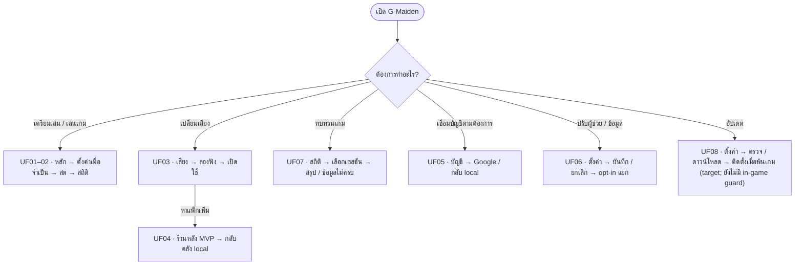
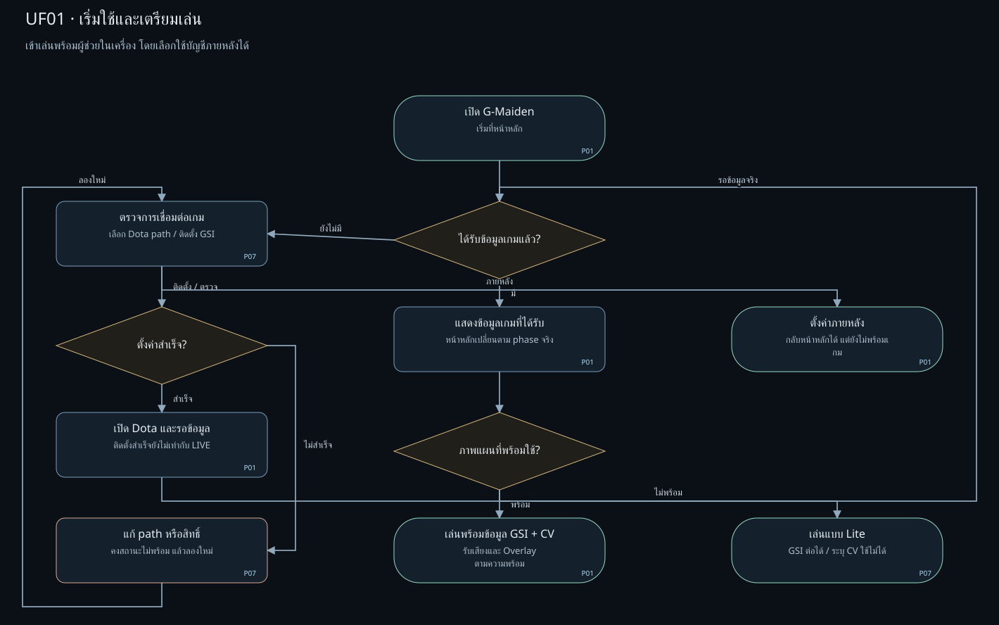
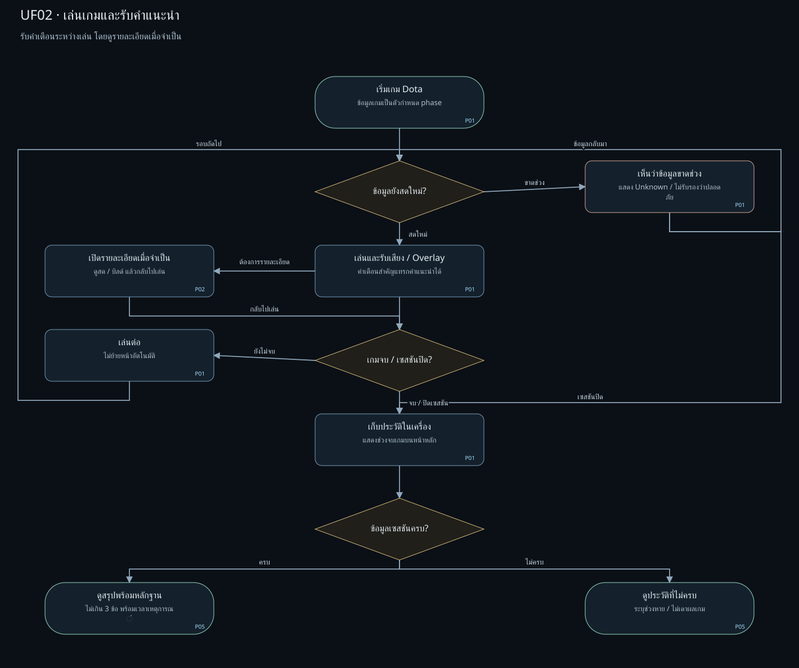
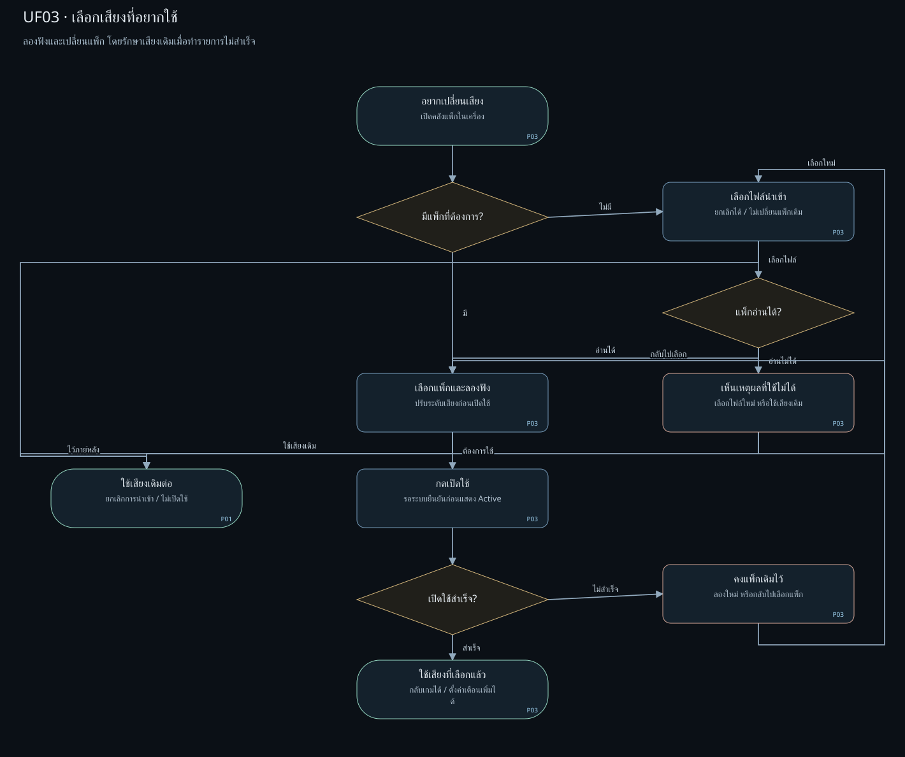
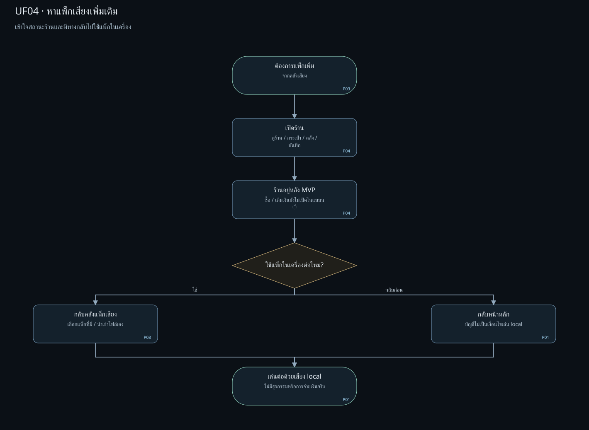
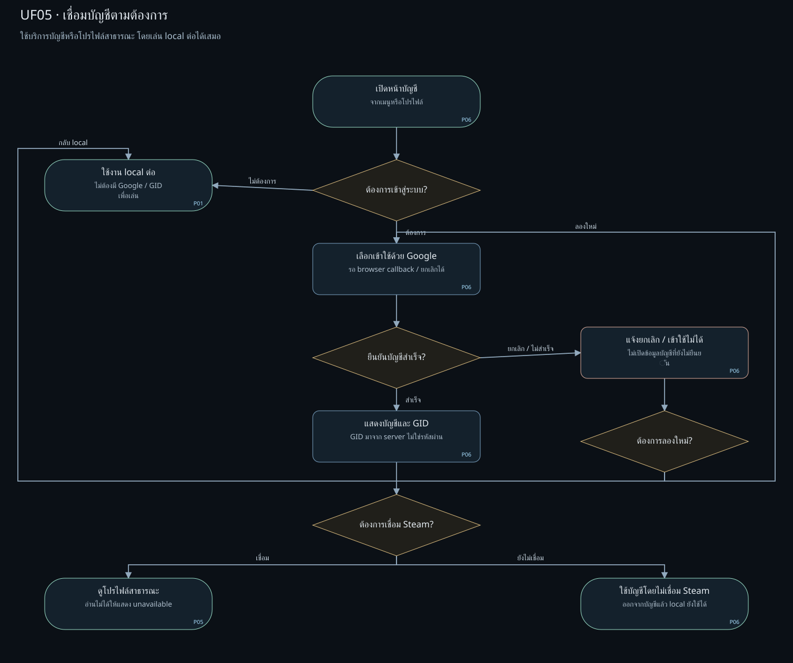
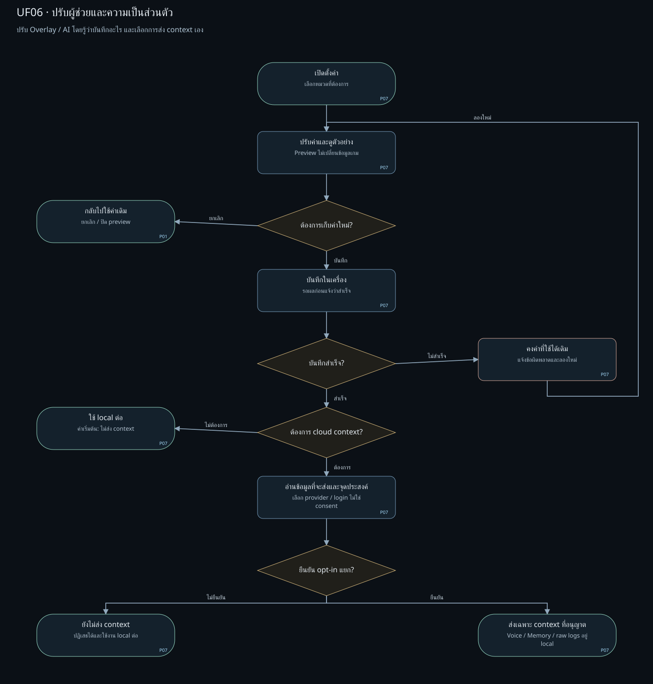
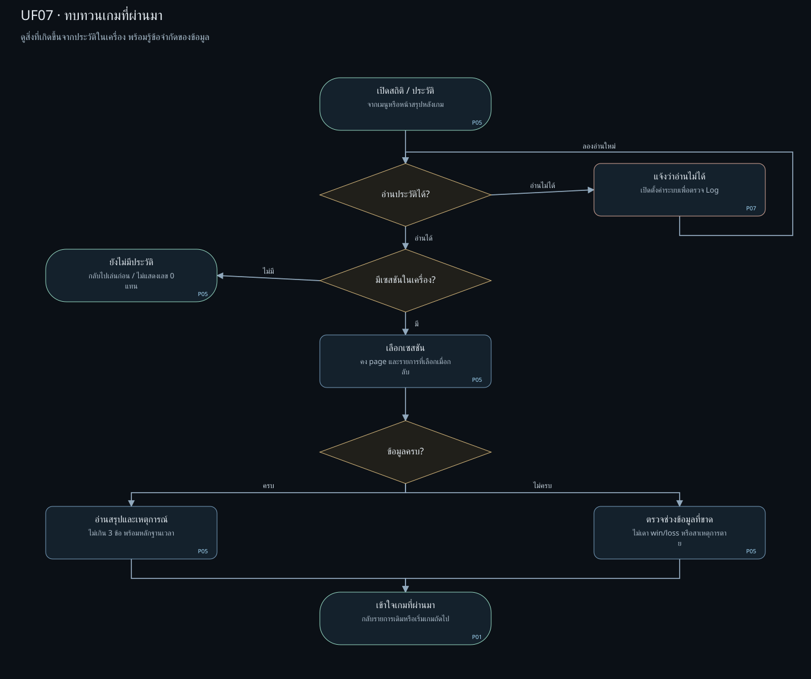
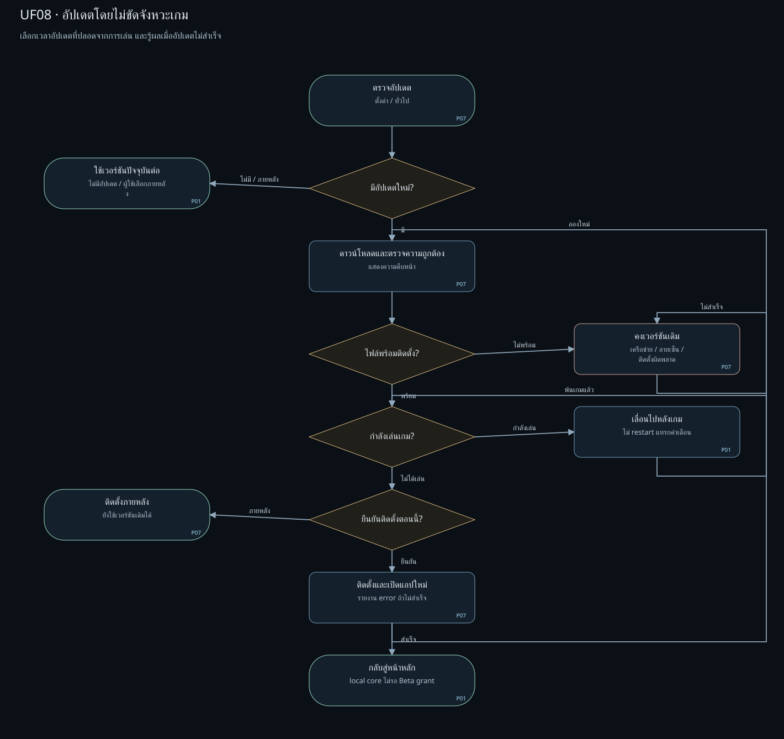

# User Flow — ผู้ใช้ต้องการอะไร และไปต่ออย่างไร

แบบเป้าหมายสำหรับผู้เล่น Dota 2 ที่ต้องการผู้ช่วยระหว่างเกม โดยคงกริดและกรอบโค้งของ [[10-wireframes]].
[เปิด User Flow แบบกดได้](assets/wireframes/index.html#user-flow/UF01); เลือกเป้าหมายจากรายการด้านบน.
กดขั้นตอนที่มีรหัส P01–P07 เพื่อเปิด wireframe และกด “ดู Wireflow ที่เกี่ยวข้อง” เพื่อดูหน้าจอเรียงตามเส้นทางนั้น.

| เอกสาร | ใช้ตอบคำถาม |
| --- | --- |
| [[10-wireframes]] | ข้อมูลและปุ่มวางตรงไหนในแต่ละหน้า |
| [[11-wireflows]] | จากหน้าหนึ่งกดอะไรไปอีกหน้า พร้อมหน้าตาระหว่างทาง |
| **User Flow ฉบับนี้** | ผู้ใช้มีเป้าหมายอะไร ต้องตัดสินใจตรงไหน และจบด้วยผลอะไร |

## 1. ขอบเขตและสัญลักษณ์

- วงรี = จุดเริ่มหรือผลลัพธ์; สี่เหลี่ยม = การกระทำของผู้ใช้ / ระบบตอบสนอง; ข้าวหลามตัด = จุดตัดสินใจ.
- ป้ายลูกศรระบุเงื่อนไข; เส้นย้อนแสดงการลองใหม่หรือกลับไปตรวจข้อมูล. การเลือกหน้าไม่จำลองว่าเกมเริ่มหรือจบ.
- P01 หลัก · P02 สด · P03 เสียง · P04 ร้าน · P05 สถิติ · P06 บัญชี · P07 ตั้งค่า.
- เป็น **target UX ตาม [[mvp-decisions]]**. ใน source baseline `origin/main` `App.tsx` mount `CommandDeck` โดยตรง; ไม่พบ `GmadFirstRunGate` component หรือ mount ใน source tree. Store components ยัง mount อยู่และมี call path สำหรับ purchase/top-up; การมี path ไม่ยืนยัน provider หรือธุรกรรมจริง. การทำแบบไม่ใช่หลักฐานการทำงานของ runtime.
- ใน viewer ทุกลิงก์เปิดเพียงแบบ/สถานะตัวอย่าง; ไม่เรียกบัญชี เกม เสียง payment filesystem หรือ updater.
- Account optional, local core ใช้ได้ขณะ signed-out/offline; cloud context ปิดเป็นค่าเริ่มต้น; Voice/Memory/raw logs อยู่ในเครื่อง.
- Route-by-route source crosswalk UF01–UF08 และ code gaps ที่ยืนยันได้อยู่ใน [[mvp-backlog]].

## 2. ภาพรวมจากเป้าหมายผู้ใช้

## 3. UF01 — เริ่มใช้และเตรียมเล่น

**เป้าหมาย:** เข้าเล่นพร้อมผู้ช่วยในเครื่อง โดยเลือกใช้บัญชีภายหลังได้. จุดเข้า P01/standby; จับคู่ F01.

ตรวจว่ามีข้อมูลเกมจริงหรือยัง → ถ้ายังไม่มี เปิด P07/system เพื่อตรวจ path/GSI → ตรวจผล → เปิด Dota และรอ valid tick.
ติดตั้ง config สำเร็จอย่างเดียวไม่ขึ้น LIVE. เมื่อตั้งค่าไม่สำเร็จมีทางแก้และลองใหม่; “ภายหลัง” กลับหน้าหลักโดยยังบอกว่าไม่พร้อม.
เมื่อมี GSI แล้วตรวจ CV: พร้อมใช้ข้อมูลทั้งสองแหล่ง; ไม่พร้อมใช้ Lite และระบุข้อจำกัด. ผลสำเร็จคือความพร้อมที่ตรวจได้ ไม่ใช่จำนวนขั้นตอนที่กดครบ.

## 4. UF02 — เล่นเกมและรับคำแนะนำ

**เป้าหมาย:** ได้เสียง/Overlay โดยไม่ต้องคอยสลับหน้าจอ. จุดเข้า P01/prep; จับคู่ F02.

ข้อมูลสด → เล่นและรับคำเตือน → เปิด P02/live เมื่ออยากดูละเอียด → เล่นต่อจนเกมจบ/เซสชันถูกปิด → เก็บ local history.
ข้อมูลขาดช่วงต้องเห็น Unknown และรอข้อมูลกลับ; ไม่ถือว่าศัตรูปลอดภัย. ถ้าเกมจบขณะข้อมูลหาย ให้เข้า archive/partial ตามหลักฐาน ไม่ต้องรอ tick กลับเพื่อแสดงประวัติ.
Complete → สรุปไม่เกิน 3 ข้อพร้อมเหตุการณ์/เวลา; partial → แสดงช่วงขาด ไม่เดาผลเกมหรือสาเหตุการตาย.
G-Signal แทรกเสียงคำแนะนำได้; belief revision แก้คำพูดตาม [[07-combat-hud]].

## 5. UF03 — เลือกเสียงที่อยากใช้

**เป้าหมาย:** ลองฟังและเปลี่ยนแพ็กอย่างมั่นใจ. จุดเข้า P03/inventory; จับคู่ F03.

มีแพ็ก → เลือก/ลองฟัง; ไม่มี → นำเข้าไฟล์ → ตรวจว่าอ่านได้ → ลองฟัง → เปิดใช้ → รอระบบยืนยัน.
ไฟล์ไม่ถูกต้องหรือเปิดใช้ไม่สำเร็จคง active pack เดิม; เลือกใหม่/ลองใหม่หรือกลับ local ได้. ยกเลิกไม่เปลี่ยนคลังหรือแพ็กที่ใช้อยู่.
กรณี editor เพิ่มเติม: แก้ mapping → บันทึก → success/error; เมื่อออกขณะมีงานค้างให้เลือก **บันทึก / ทิ้ง / อยู่ต่อ** ตาม F03. การลองฟังไม่สร้างเหตุการณ์เกมจริง.

## 6. UF04 — หาแพ็กเสียงเพิ่มเติม

**เป้าหมาย:** เข้าใจสถานะร้านและกลับไปใช้งานได้. จุดเข้า P03 → P04; จับคู่ F04.

เปิดร้าน → เห็นว่าธุรกรรมอยู่หลัง MVP → เลือกกลับ P03 เพื่อใช้/นำเข้าแพ็กในเครื่อง หรือกลับ P01 ใช้เสียงเดิม.
เก็บ tabs ร้าน/กระเป๋า/คลัง/บันทึกให้ครบในแบบ แต่ไม่มีขั้นซื้อ เติมเงิน receipt หรือ faucet. ไม่บังคับบัญชีเพื่อออกจากหน้านี้.

## 7. UF05 — เชื่อมบัญชีตามต้องการ

**เป้าหมาย:** ใช้บริการบัญชีหรือโปรไฟล์สาธารณะ. จุดเข้า P06 จากเมนู I หรือโปรไฟล์ H; จับคู่ F05.

เลือกว่าจะเข้าสู่ระบบหรือกลับ local → Google → รอ callback ที่ตรวจแล้ว → สำเร็จแสดงบัญชี/GID → เลือกเชื่อม Steam หรือข้าม.
ยกเลิก/timeout/network error → แจ้งเหตุผล → ลองใหม่หรือกลับ local. Google เป็น primary sign-in; GID/Steam ไม่เป็น password/recovery.
Steam ใช้โปรไฟล์สาธารณะ; การอ่านไม่สำเร็จแสดง unavailable และไม่แทนที่ local history.
Sign-out/expired/revoke ปิดเฉพาะ account actions และล้าง session/cache ของบัญชี; ไม่ลบประวัติ local หรือหยุดเกม. ไม่เพิ่ม MFA/recovery enrollment ในงานนี้.

## 8. UF06 — ปรับผู้ช่วยและความเป็นส่วนตัว

**เป้าหมาย:** เลือกค่าที่ใช้งานและเข้าใจข้อมูลที่ส่ง. จุดเข้า P07; จับคู่ F06.

เลือกหมวด → ปรับ/preview → บันทึกหรือยกเลิก → ตรวจผลบันทึก → เลือกใช้ local ต่อหรืออ่านขอบเขต cloud context → ยืนยัน opt-in แยกหรือปฏิเสธ.
บันทึกพลาดคงค่าที่ใช้ได้เดิม; ปิด preview คืนค่าที่บันทึก. Login/provider/Ask ไม่ถือเป็น consent.
Opt-in ส่งได้เฉพาะ allowlist ตาม [[mvp-decisions]]; raw GSI/CV/Memory/Voice/logs ไม่ส่ง. ปิด opt-in หยุด future sends และทิ้งผลตอบกลับจากบริบทเก่า.
กรณีลบข้อมูล: เลือก scope → ยืนยัน/ยกเลิก → รายงานสิ่งที่ลบจริง; error/partial ระบุที่เหลือ. นี่เป็น contract ในแบบ ไม่ใช่การอนุมัติให้ลบไฟล์.

## 9. UF07 — ทบทวนเกมที่ผ่านมา

**เป้าหมาย:** เข้าใจสิ่งที่เกิดขึ้นจากหลักฐานในเครื่อง. จุดเข้า P05/history หรือ P01/debrief; จับคู่ F07.

อ่านรายการ → มีเซสชันหรือไม่ → เลือกเซสชัน → ตรวจ completeness → ดู summary/timeline หรือช่วงที่ข้อมูลหาย → กลับรายการเดิม/เล่นต่อ.
Loading ไม่แสดงเลข 0 แทนข้อมูล; ไม่มีรายการเป็น empty; อ่านไม่ได้ไป P07/system เพื่อตรวจ Log แล้วลองใหม่.
คง page/selection เมื่อไปตั้งค่าแล้วกลับ; หากไฟล์หาย แสดง unavailable ตามจริง. การดูประวัติไม่ต้องเชื่อม Google หรือ Steam.

## 10. UF08 — อัปเดตโดยไม่ขัดจังหวะเกม

**เป้าหมาย:** เลือกเวลาอัปเดตและรู้ผล. จุดเข้า P07/general; จับคู่ F08.

ตรวจอัปเดต → ไม่มี/ภายหลังใช้เวอร์ชันเดิม → มีอัปเดตให้ดาวน์โหลดและตรวจ → ถ้ากำลังเล่นให้เลื่อน → เมื่อพ้นเกมให้ผู้ใช้ยืนยันติดตั้ง → เปิดแอปใหม่.
เครือข่าย/ลายเซ็น/ติดตั้งผิดพลาดต้องแจ้ง error และรักษาเวอร์ชันเดิม; retry ไม่ใช่ “อัปเดตสำเร็จ”. ไม่ auto-restart ทับ gameplay.
Signed stable/local-core entrance เป็น target ตามมติ MVP; release pipeline/signature และ account service requirements ยังคงมี gate ของตน.

## 11. Traceability และการตรวจ

| User Flow | Wireflow | หน้าหลักที่เกี่ยวข้อง |
| --- | --- | --- |
| UF01 | F01 | P01, P07 |
| UF02 | F02 | P01, P02, P05 |
| UF03 | F03 | P03, P01; เพิ่ม P07/voice ตาม F03 |
| UF04 | F04 | P03, P04, P01 |
| UF05 | F05 | P06, P05, P01 |
| UF06 | F06 | P07, P01 |
| UF07 | F07 | P05, P07 |
| UF08 | F08 | P07, P01 |

Diagram model คือ `assets/wireframes/user-flows.js`; generator เดียวกับ [[10-wireframes]] สร้าง SVG และบันทึก nodes/edges/goals ใน `manifest.json`.
ตรวจ ID ไม่ซ้ำ, edge มีปลายทาง, ทุก node เข้าถึงได้จาก start, decision มีอย่างน้อย 2 ป้ายทางเลือก และลิงก์ทุกขั้นชี้ route/state ที่มีจริง.
การตรวจกราฟ/ลิงก์เป็นหลักฐานของเอกสารและ viewer; ไม่แทน usability test กับผู้เล่น, native E2E หรือการตรวจ security migration.

## Changelog

| Version | Date | Summary |
| --- | --- | --- |
| 1.0.0 | 2026-10-12 | Added eight goal-based user flows with decisions, retry/cancel paths, outcomes, screen links and wireflow mapping. |
| 1.0.1 | 2026-10-19 | แก้คำอธิบาย first-run gate และระบุ in-game update guard เป็น target ที่ยังไม่มีใน handler ปัจจุบัน |
| 1.0.2 | 2026-10-19 | ลิงก์ source crosswalk UF01–UF08 ใน backlog เพื่อแยก user-flow target จาก implementation snapshot |
