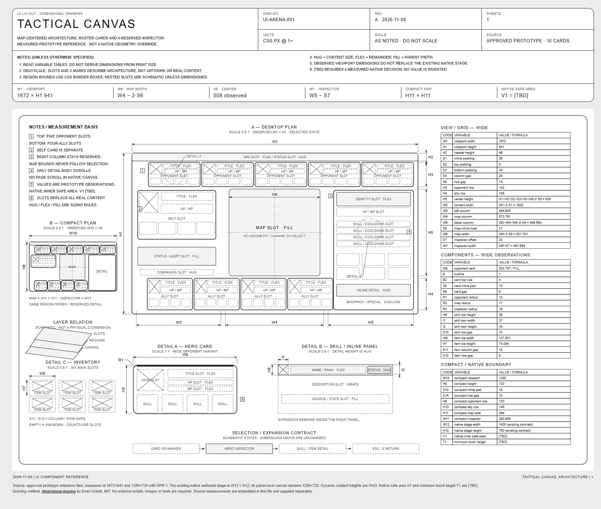

# Arena layout dimensional drawing

แผ่น UI-ARENA-001 ใช้ [dimensional-drawing](https://github.com/enesozturk/dimensional-drawing) ตามคำขอผู้ใช้ เพื่ออธิบาย layout ของ prototype ที่อนุมัติใน [[FEAT-G-ARENA]].
เป็นแบบอ้างอิงเพื่อ implementation; ไม่ใช่ผลตรวจรับ production หรือการเปลี่ยน geometry ของ [[03-layout]].

- [เปิด HTML แบบ self-contained](assets/arena-hero-inspector-20261108/arena-layout-dimensional.html)
- [SVG แผ่นเขียนแบบ](assets/arena-hero-inspector-20261108/arena-layout-dimensional.svg)
- [ค่าที่วัดจาก prototype](assets/arena-hero-inspector-20261108/layout-measurements.json)
- [ผลตรวจแผ่นภาพ](assets/arena-hero-inspector-20261108/layout-drawing-qa.json)

## ขอบเขตแผ่นภาพ

| View | ใช้สำหรับ |
| --- | --- |
| Desktop plan | ตำแหน่งแมป, ศัตรู 5 ช่องด้านบน, เพื่อน 4 ช่องด้านล่าง, ตัวเองซ้าย และ inspector ขวา |
| Compact plan | เปรียบเทียบการจัดพื้นที่ที่ viewport 1280×720; ไม่ใช่การออกแบบ mobile เพิ่ม |
| Detail A | anatomy ของ hero card: portrait, identity, HP/MP และ skill slots |
| Detail B | skill/cooldown row และ inline detail ที่ขยายใน inspector |
| Detail C | main inventory 6 ช่อง พร้อมช่องว่างระหว่างแถว/คอลัมน์ |
| Selection flow | card/marker → inspector → skill/item detail → Esc/X return โดยแมปคง bounds เดิม |

ขาวดำและ placeholder slots เป็นรูปแบบของ technical drawing; production ยังคงใช้สี/ภาพตาม prototype และ tokens ที่ยอมรับ.
ตำแหน่ง region และมิติที่มีรหัสวัดจาก browser; nested slots ที่ไม่มีรหัสเป็น schematic เพื่อแสดงหน้าที่ ไม่ใช่ค่าระยะตายตัว.
ทุก dimension code มีตารางตัวแปร และสูตรใช้ border-box CSS px ที่ DPR 1; ค่าทศนิยมในตารางปัดเพื่ออ่านง่าย.

## หลักฐานและขอบเขตของตัวเลข

วัดด้วย browser Playwright DOM API หลังโหลด font ที่ viewport 1672×941 และ 1280×720.
ตรวจ source App.jsx/data.js/styles.css ว่าตรงกับ reference ที่ commit ใน PR #165 head `4f0ef5179ec11856ea9d5cf296ee5fd969dc2272`.
สำรวจการ์ดครบ 10 ใบและ skill preview 40 ช่อง; ไม่ถือว่าขนาด skill tile ทุกใบเท่ากัน.
ค่าที่วัดและ SHA-256 อยู่ใน layout-measurements.json และ prototype-manifest.json.

| Observation | Wide prototype | Compact prototype |
| --- | --- | --- |
| Viewport | 1672×941 | 1280×720 |
| Map border box | 531.78125×508 | 369×369 |
| Inspector border box | 467.59375×700 | 393.90625×520 |
| Map when skill detail opens | x/y/w/h unchanged in observed wide state | prior approved compact evidence remains separately recorded |

**Native boundary:** authored stage 1420×760 และ panel-local 1280×720 ยังคงใช้ contract เดิม. ห้ามนำ viewport ของ prototype ไปแทน stage dimensions.
`V1` native inner safe area และ `T1` minimum touch target เป็น **[TBD]**: agent ต้องวัดและกำหนดใน implementation review ภายใต้ ONE CANVAS/keyboard requirements.
ความสูงข้อความและรายละเอียดเป็น HUG; ห้ามใช้ความสูง fixture เป็นเพดานที่ทำให้ข้อความจริงถูกตัด.

## การตรวจภาพ

Render ที่ 1800×1500 แล้วตรวจ full-page screenshot. แก้ป้าย compact ที่แน่นเกินไป, ระยะ title/dimension และป้ายริมแผ่นก่อน export ครั้งสุดท้าย.
ผลตรวจสุดท้าย: 47 codes, undefined dimension codes 0, labels นอกกรอบ 0, external scripts/images/fonts 0; ตรวจสมการหลัก 4 สูตรผ่าน.
HTML, SVG, JPEG และ JSON เป็น artifact สำหรับอ่าน/เทียบแบบเท่านั้น ไม่ถูก import เข้า production.
ยังไม่มี native UI/live-game/NFR acceptance จากงานนี้.

## Attribution

Drawing helpers ดัดแปลงจาก `examples/card-sheet.html` ของ enesozturk/dimensional-drawing, MIT, Copyright (c) 2026 Enes Ozturk.
เก็บ license ไว้ใน [drawing-kit-LICENSE.txt](assets/arena-hero-inspector-20261108/drawing-kit-LICENSE.txt) และใน HTML.
ไม่ใช้ HG assets หรือภาพเกมจริงในแผ่น schematic.

## Changelog

| Version | Date | Summary |
| --- | --- | --- |
| 0.1.0 | 2026-11-08 | เพิ่ม measured monochrome layout sheet พร้อมสอง viewport, card/skill/item details, variable tables และ native geometry boundary. |

