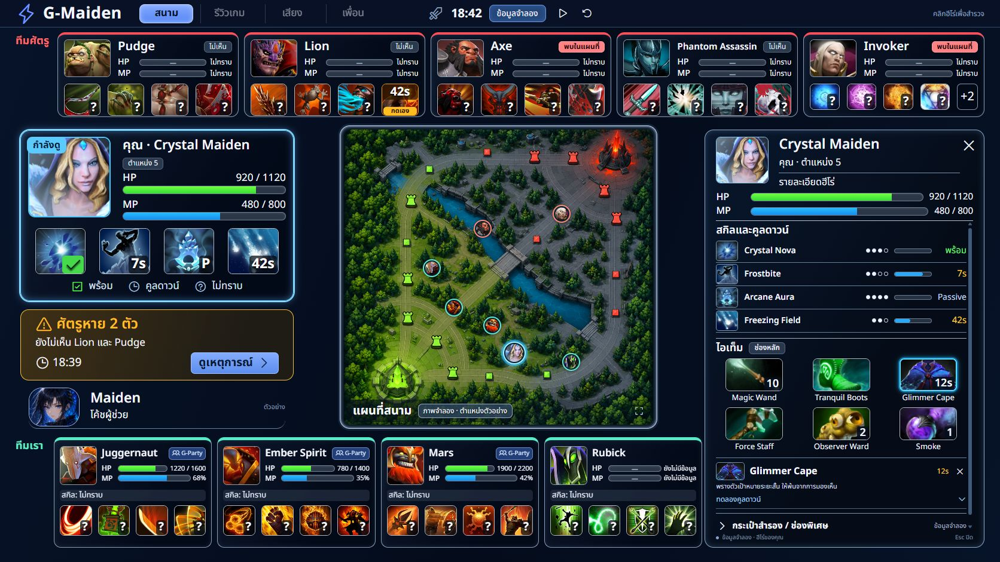
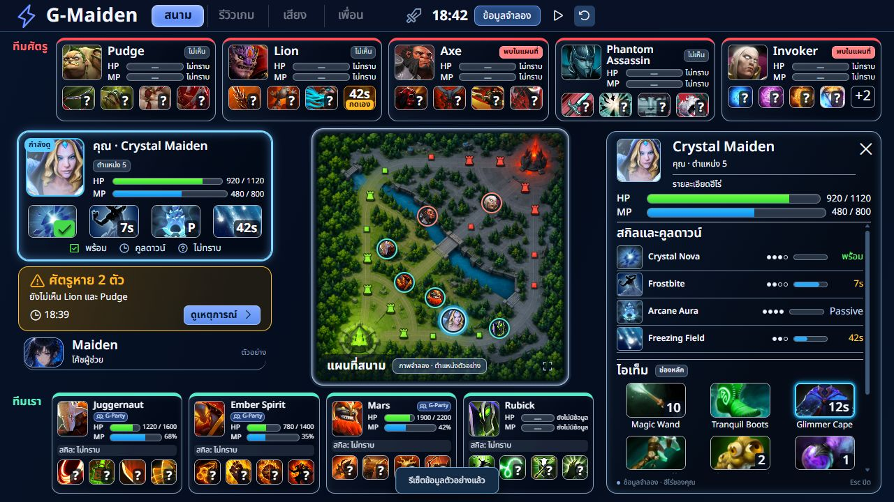

# FEAT-G-ARENA — สนามกลางและ Hero Inspector

**Phase:** P3 extension · **Status:** planned / doc-only · **Design direction:** ผู้ใช้อนุมัติ prototype และสั่งส่งต่อเพื่อ implementation เมื่อ 2026-11-08.
ข้อกำหนด authoritative คือ [[software-requirements-specification]] §4.1A; เอกสารนี้กำหนด behavior/data contract และ test oracle.
ไม่ใช่ declaration ว่า production UI, ownership admission, native timer หรือ live acceptance เสร็จแล้ว.

## 1. แบบที่ต้องทำ

ภาพจาก prototype ที่ผู้ใช้อนุมัติเป็น visual reference หลัก; JSX/CSS/data อ้างอิงและ hashes อยู่ใน [ชุดอ้างอิง](../design-system/assets/arena-hero-inspector-20261108/prototype-manifest.json).
ภาพประกอบแมปเป็น artwork จำลอง; ไม่ใช่ screenshot จาก match, calibration surface หรือหลักฐานตำแหน่งเกมจริง.
ใช้ actual CV preview/geometry ที่ตรวจสอบแล้วใน production; artwork fallback ต้องติดป้ายว่าไม่มีข้อมูลสดและไม่วาง live markers บน geometry ที่ไม่ตรง.

| Region | Content / behavior |
| --- | --- |
| Top | ศัตรู 5 การ์ด, HP/MP/skill status ตามสิทธิ์ข้อมูล; identity ที่ไม่ทราบแสดง placeholder |
| Left | การ์ดตัวเอง, existing missing/status information เมื่อมีแหล่งข้อมูล, Maiden mascot แยกจาก Crystal Maiden portrait |
| Center | แมปที่มีพื้นที่มากที่สุดในสนาม, marker ที่รู้ตัวตนคลิกได้, ขอบเขตคงที่เมื่อ inspect |
| Bottom | เพื่อนร่วมทีม 4 การ์ด; ไม่รวมตัวเองซ้ำ, stable player slots |
| Right | Reserved inspector: overview + skills + items + inline detail; ปิดแล้วเป็น neutral empty panel และไม่คืนพื้นที่ให้แมป |
| Existing chrome | คง Deck navigation/shortcuts/other tabs; ป้าย demo และ clock controls อยู่ใน fixture mode เท่านั้น |

Routing: body ของ Live > สด เปลี่ยนเป็นสนาม; Build/CV/G-Party tabs และหน้าหลักอื่นยังเข้าถึงได้.
ใช้ CommandDeck เป็นเจ้าของ useParty/useFriends เดิม. Arena รับ read model จาก owner เดียว; ห้าม mount relay controller ใหม่.
Prototype ไม่ได้กำหนดให้ลบหรือ disable เมนู production ที่ไม่มีในตัวอย่าง.
Inner Arena layout ใช้แบบใหม่นี้แทน anatomy เดิมเฉพาะหน้า สนาม; outer stage และ ONE CANVAS จาก [[03-layout]]/[[05-sitemap-ia]] ยังใช้เดิม.

รายละเอียด layout แบบขาวดำและตารางระยะที่วัดจริงอยู่ใน [[arena-layout-dimensional]] (HTML/SVG/JPEG). ใช้เทียบ region/card/inspector; native stage เดิมและค่า [TBD] ไม่ถูกแทนด้วยขนาด viewport ของ prototype.

## 2. MVP และสิ่งที่ยังไม่รวม

MVP มี roster, HP/MP/status previews, stable center map, selection, skill/item inspector, source/unknown/stale states, keyboard/focus และ deterministic fixture harness.
Production แสดงข้อมูลจริงเท่าที่ source admission ยืนยันได้. UI พร้อมกับ unknown เป็น milestone ที่ส่ง review ได้ แต่ไม่ใช่การผ่านเกณฑ์ live skill/item โดยอัตโนมัติ.

ไม่รวมการเปิดเผย enemy/peer information ใหม่, auto enemy skill inference, spectator backend, replay scrubber, item shop/casting, global navigation redesign, mobile product หรือการเพิ่ม Party payload.
งาน G-Review/G-BuildPlan ไม่ถูกย้ายมาเป็น scope ของ Arena. คงลำดับ tactical handoff เดิม TT-00 → TT-R1 → TT-R2.
[PR #154](https://github.com/Freshair129/G-Maiden/pull/154) ยังเป็น draft/open ณ baseline ที่ตรวจ; conflict และการ merge ของ PR นั้นไม่ใช่เหตุให้เลื่อน layout/interaction fixtures ทั้งหมด.
Native manual timer integration ต้องรอ contract/store ที่ reviewed; เมื่อยังไม่มีให้ disabled action พร้อมเหตุผลที่อ่านได้ ไม่สร้าง timer backend สำเนาใน React.

## 3. Interaction contract

1. Initial: roster เท่าที่รู้, แมปหรือ unavailable state, inspector neutral. Fixture entrypoint เริ่ม Crystal Maiden selected ตามภาพ เพื่อสาธิตได้ทันที.
2. Card/known marker click: select HeroKey เดียว, update heading/vitals/skills/items, reset inline detail, backpack collapse และ scrollTop=0. ห้าม pan/resize แมป.
3. Skill click: inline detail ในขวา แสดง catalog description, hotkey/rank เฉพาะเมื่อมี, passive/not-learned/readiness/cooldown source. รายการเต็มไม่จำกัด 4; preview +N เปิดรายการเดียวกัน.
4. Item click: inline detail พร้อม inventory location, count/charges เมื่อมี, cooldown และ source. unknown slot ไม่อ้างว่าฮีโร่ไม่มี item.
5. Click slot/detail ไม่สั่ง Dota และไม่แก้ loadout. Collapse detail กลับ overview; X ปิด inspectorแต่เก็บ map bounds.
6. Esc ถ้ามี inline detail ให้ปิด detailก่อน; Esc ถัดไปปิด inspector. เมื่อปิดคืน focus ไปการ์ดที่เลือกถ้ายังอยู่ ไม่ trap focus แบบ modal. ไม่ดัก Esc เมื่อ descendant control ใช้ Esc จัดการ editing ของตัวเอง.
7. Keyboard: Enter/Space เลือกการ์ด/marker/skill/item; focus ring ชัด, status ไม่ใช้สีอย่างเดียว. ไม่ย้าย keyboard focus เมื่อข้อมูล live refresh.
8. สลับฮีโร่หรือปิด inspectorไม่ยกเลิก timer. เปลี่ยน session/identity/source generation จึง invalidate ตามข้อ 4.
9. Toast/tooltip ต้องไม่บัง map center, ไม่เด้งทุก tick; screen reader ประกาศ selection และ user action แทนประกาศ countdownทุกวินาที.

## 4. Read model และข้อมูลที่ต้องเก็บ

เก็บเฉพาะ in-memory view state และ source snapshots ที่ได้รับอนุญาต; ไม่เพิ่ม telemetry, persistent match store, cloud หรือ AI context.
ชื่อด้านล่างเป็น proposed view model ไม่ใช่คำสั่งเปลี่ยน native IPC โดยยังไม่ review.

| Data | Fields / rules |
| --- | --- |
| HeroKey | sessionEpoch, team, playerSlot; heroId/revision เป็น identity guard; ห้ามใช้ชื่อฮีโร่เป็น unique key |
| FieldState<T> | value nullable, availability: known/unknown/stale/unavailable, source: own-gsi/party/cv/catalog/manual, observedAt/ageMs ตาม producer, sourceGeneration, revision |
| HeroView | HeroKey, admitted identity, level/alive/respawn, HP current/max หรือ HP%, MP current/max เฉพาะเมื่อมีหรือ MP%; unknown ไม่ใช่ zero |
| SkillView[] | stable slot/key, canonical name/icon/catalog revision, learned level nullable, passive, canCast nullable, castCooldown nullable, charges/maxCharges/recharge nullable; ability_active ไม่แปลว่า ready |
| ItemSlotView[] | inventory group+slot, known empty แยก unknown, itemId nullable, stack/count แยก charges, cooldown/recharge, enabled/disabled เมื่อ source มี |
| MapView | current frame/region.side, health, geometry/session generations, admitted detections x/y pixel, identity association; normalizeก่อนlayout |
| InspectorState | selected HeroKey+identity revision, selected detail kind/key, backpack expanded, local scroll; ไม่เป็น timer owner |
| TimerRef | match/session+enemy slot+kind(ULT/BKB/TP), native revision, start/end game time, manual source; React render อย่างเดียว |

### 4.1 Source availability ณ main 6a26d628992f0267ef4d848d92f2050bdbfa3c0f

| Source inspected | Evidence / implementation implication |
| --- | --- |
| src/src/live/events.ts GameTick | hp_percent/mana_percent และ optional item_names มี; ไม่ใช่ full HP/MP numerator/max, slot inventory, charges หรือ ability DTO. ห้าม fabricate fields จากชื่อ item/percent |
| src-tauri/src/gsi.rs / gsi_ability.rs | CR-039 parses selected-unit AbilityCandidate แล้วไม่ serialize/emit/share/log; verified SteamID ไม่พิสูจน์ skill ownership. ห้ามต่อ candidate เข้า inspector โดยตรง |
| src/src/live/events.ts MinimapCv | detection x/y เป็น pixel ภายใน region.side ไม่ใช่ normalized; ต้องตรวจ health/session/geometry, ไม่อ้างว่า CV ต่อเนื่อง 60fps |
| DraftRoster / live/buildHeroes.ts | slot-preserving roster มี null; ใช้ stable slots ไม่สร้าง unknown heroes จาก fixture |
| FEAT-G-PARTY / party owner | narrow relay own stats มี freshness/null contract; ไม่ส่ง abilities/items/positions และไม่อนุมานว่าฮีโร่ party member อยู่ตำแหน่งใดบนแมป |

UI adapter ใช้ admitted producers ที่มีอยู่ก่อน. หากต้องเพิ่ม own stats/item projection ให้แยก typed DTO ที่ระบุ selected-unit attribution, validation, generation และ privacy tests;
ห้ามต่อ raw payload ทั้งก้อนเข้า WebView หรือเปลี่ยน GameTick ให้กลายเป็น API ส่ง skill/AI โดยไม่ผ่าน CR-039 admission review.
ก่อนเปิด live own skills ต้องมี real player-mode fixtures ที่เลือก own hero/ally/enemy/creep/illusion และ ownership fence ผ่าน; mock identity test ไม่แทนหลักฐานนี้.
Skill catalog/description แสดงได้เมื่อรู้ hero identity และ catalog revision แม้ dynamic status ยัง unknown. Passive/catalog label ต้องแยกจาก measured learned rank.
Party stale TTL ใช้ contract เดิม (2000/2001ms boundary); sample ถูกถอนต้องล้าง HP/MP. Own GSI freshness ใช้ producer status เดิม ไม่สร้าง threshold คู่ขนาน.

### 4.2 Status และ timer

| State | Display | Source rule |
| --- | --- | --- |
| observed ready | พร้อม / castable ตามที่ยืนยันได้ | cooldown 0 อย่างเดียวไม่สรุป canCast; mana/silence/charges ไม่ครบให้ระบุความไม่แน่นอน |
| observed cooldown | countdown + source/age | ใช้ admitted native clock/snapshot; ไม่ใช้ browser wall clock เป็น authority |
| passive / not-learned | ติดตัว / ยังไม่เรียน | passive catalog กับ learned rank ต้องไม่ปะปน |
| unknown / unavailable | — / ยังไม่มีข้อมูล | ไม่เดา 0, ready, empty หรือ full HP |
| stale | ข้อมูลเก่า + age; ห้ามอ้างว่าสด | stale inventory/skill ไม่ใช้เพื่อแสดง affirmative-ready; peer sample withdrawn เป็น null |
| manual running | คาดการณ์ · ผู้ใช้ตั้ง | แยกจาก observed state, ไม่เขียนทับ observation |
| manual expired | คาดว่าพร้อม | ไม่ยกระดับเป็น observed-ready |
| cancelled | ไม่ทราบ | ไม่แปลง cancel เป็น ready |

PR #154 G-Cooldown MVP จำกัด enemy ULT/BKB/TP สูงสุด 15 keys, native game-clock/pause/stale/session/revision fences.
Duration/catalog revision ยึด reviewed contract ของงานนั้น. หาก clock stale ให้ freeze และติดป้าย; หากเกม pause ให้ freezeตาม authoritative game time; resume ไม่วิ่งเองด้วย elapsed walltime.
Prototype ยอมกรอก 1..1800 วินาทีและจำลอง self/any skill/item เพื่อสำรวจ UI เท่านั้น; **ไม่ขยาย production timer scope**.
Fixture Lion ULT 42s, Blink/BKB และ roster ทั้งหมดเป็นค่าจำลอง ห้าม seed เมื่อเริ่ม live.

## 5. Visual, responsive และ assets

- รักษาลำดับชั้นของภาพ: map ใหญ่กลาง, enemy top / ally bottom, compact card status, inspector right; ใช้ --g-* tokens และ readable Thai typography.
- Desktop acceptance วัด content bounds และ DPI จริงที่ 1280×720, 1440×900 และ 1672×941 window references; screenshot prototype ไม่ใช่ค่า outer Tauri chrome.
- authored Deck stage 1420×760 และ panel-local 1280×720 ยังคงเดิม. Resize fit stage; overflowใช้ bounded inspector tabs/scroll. ห้าม body/page scrollbar, fontsหดเพื่อยัดข้อมูล หรือซ่อน map เมื่อเลือก.
- Inspector reserve width ทั้ง open/closed; bound delta ≤1 CSS px ใน viewport เดิม. Marker movementจากข้อมูลใหม่ไม่ถือเป็น layout shift; test freeze input ก่อนวัด.
- Mobile390/tablet1024 ใน prototypeเป็น exploratory browser views ไม่ใช่ production ONE CANVAS waiver.
- ใช้ project assets/catalog เมื่อมี. Missing image แสดงชื่อ/placeholderโดยไม่เปลี่ยนขนาดช่อง. Maiden mascot เป็น companion แยกจาก Crystal Maiden hero.
- Dota art belongs to Valve; Phosphor MIT, Noto Sans Thai OFL, map generated, mascot supplied project asset. Screenshot เป็น design fixture. ตรวจ asset rights/catalog revision ก่อน packaging; ไม่คัดลอก HG binary/assets.

## 6. Acceptance matrix

ทุกแถวเริ่ม **NOT RUN for production**. Synthetic prototype checks อยู่แยกใน evidence file; ไม่ใช้ปิด production row.

| Case → SRS | Setup/action | Expected / evidence |
| --- | --- | --- |
| ARENA-AC-001 → FR-001 | เปิด Live > สด แล้วไป Build/CV/Party/other pages และกลับ | Arena routeถูก, existingnav/shortcutsและone party/friends ownerยังทำงาน; route tests |
| ARENA-AC-002 → FR-002 | complete roster แล้ว null slots/no-match | 5 + 4 + 1, self ไม่ซ้ำ, unknown ไม่ถูกเติม fixture; screenshots |
| ARENA-AC-003 → FR-003 | known/null HP/MP, 4 / 6 / 0 skills | vitals ตรง source, preview 4 / +N, รายการเต็มไม่ตกหล่น; tests+visual |
| ARENA-AC-004 → FR-004 | คลิกทั้ง 10 cards และทุก known marker | heading / selection / marker ตรง key; unknown marker ไม่เปิดผิด hero |
| ARENA-AC-005 → FR-005 | freeze data; open/switch/close/expand skill/item/backpack | map x/y/w/h delta ≤1 CSS px ทุก action; inspector ไม่ทับแมป |
| ARENA-AC-006 → FR-006 | คลิก active/passive/extra/stolen/unknown skill | detail / rank / source ตรง key และ revision; no stale async substitution |
| ARENA-AC-007 → FR-007 | ready / CD 0 but no mana / unknown canCast / passive / unlearned / charges | distinct labels, no false castability; cast CD ไม่ปน recharge |
| ARENA-AC-008 → FR-008 | 6 main + 3 backpack + special; empty vs unavailable; consumable | slot / count / charge / detail ตรง source; no accidental cast/purchase |
| ARENA-AC-009 → FR-009 | detail → Esc → Esc, X, select new hero, return to previous hero | focus restored, scroll / detail / backpack reset, timer คงอยู่ |
| ARENA-AC-010 → FR-010 | match / source / identity generation เปลี่ยนพร้อม late event | old selection / details / timers ไม่ข้าม generation; reused hero name ไม่ชน |
| ARENA-AC-011 → FR-011 | partial stats, unknown, peer 2000 / 2001 ms | no fabricated denominator / 0; stale peer sample ถูกถอน; age/sourceอ่านได้ |
| ARENA-AC-012 → FR-012 | unverified selected-unit abilities + peer skill/item injection | no candidate / forbidden field reaches UI / relay / AI; retain gsi.rs regression test + native ownership gate |
| ARENA-AC-013 → FR-013 | known region, zero / missing region, new geometry, unhealthy / Lite | correct pixel transform; invalid markers withheld; no synthetic positions |
| ARENA-AC-014 → FR-014 | manual start / cancel / expiry / pause / stale / resume; max 15 keys | native clock authority, estimated-ready only; BLOCKED until reviewed timer store available |
| ARENA-AC-015 → FR-015 | normal production entry vs explicit fixture entry | no demo seed, arbitrary timer, simulate / play / reset controls in live |
| ARENA-AC-016 → FR-016 | keyboard only, screen-reader labels, focus during refresh | all controls reachable; unknown is not zero; no keyboard / game focus steal |
| ARENA-AC-017 → FR-017 | 3 desktop references with fixed input; open long details | no page overflow / clipped cards; map visible; actual bounds / DPI captured |
| ARENA-AC-018 → FR-018 | no-match/stale/disconnect/missingassets + selectcard | honest fallback; selection has no game / party / account side effect |
| ARENA-AC-019 → FR-019 | event / IPC / network inspection + existing NFR protocol | no broader egress or hot-path dependency; report actual native NFR status separately |
| ARENA-AC-020 → FR-020 | implementationPR evidence review | source head + tests + screenshots + native/live results or NOT_RUN explicit; no acceptance inflation |

## 7. Prototype evidence boundary

Committed reference files preserve the approved prototype source and visual/interaction evidence, not an installed G-Maiden feature.
The prototype previously passed 30 synthetic browser checks: ten hero selections, skill/item details, timer interactions, keyboard behavior and fixed map bounds.
Compact capture records 369×369 map unchanged at 1280×720, page height720 and clippedSkills0.
These are fixture observations only. No GSI/CV/Party/native game, resource budget or release acceptance was established.
The full runnable local prototype is supplied privately to the incumbent agent; committed JSX/CSS/data are reference text and are not imported by production code.

## Changelog

| Version | Date | Summary |
| --- | --- | --- |
| 0.1.0 | 2026-11-08 | บันทึกแบบ Arena/Hero Inspector ที่ผู้ใช้อนุมัติ พร้อม MVP, data/ownership boundary, production-vs-demo distinction และ acceptance20รายการ. |
| 0.1.1 | 2026-11-08 | Add the measured dimensional layout sheet and distinguish prototype dimensions from native stage constants. |
