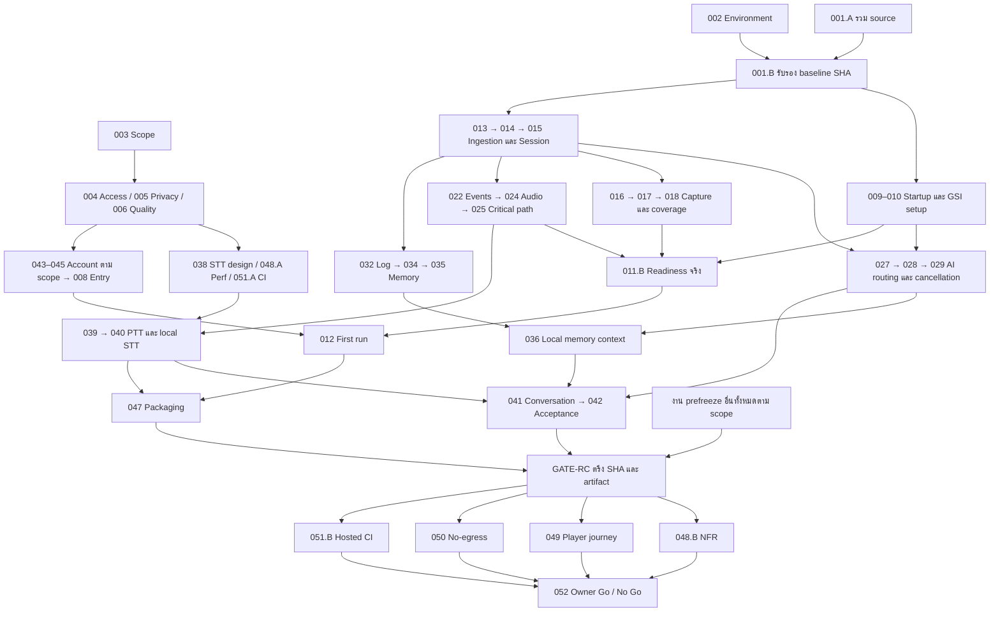

# G-Maiden MVP Execution DAG

แผนทำงานขนานสำหรับ MVP ตาม [[roadmap]] และ [[mvp-backlog]] ใช้ **ผู้ทำงาน 3 slots และผู้ประสานการรวมโค้ด 1 slot** โดยคง task แม่ MVP-001–052 และเลื่อน MVP-053–062 ตาม backlog เดิม การยกเลิก Closed Beta ยังคงมีผล

มี **57 execution nodes ใน 14 logical waves**: 52 parent tasks แยก 4 งานเป็น A/B รวมเป็น 56 task nodes และเพิ่ม GATE-RC 1 จุดสำหรับตรึง build ก่อนเก็บ evidence Owner สั่งเริ่ม execution ด้วย GPT-6 Luna ระดับ max จำนวน 3 workers แล้ว; สถานะราย node อยู่ใน JSON และ receipt ของ run โดยงานที่ยังไม่ผ่าน acceptance ไม่ถูกปิดเป็น DONE

สถานะ execution ปัจจุบัน: 001.A = INTEGRATED และ 001.B = VERIFIED บน commit `c63bad098d6e12e6f073e832dce045dbbeacd687` (tree `d687254de6c4cfc976e06e4f60e0f4dc8e038009`); Rust 315 passed / 5 ignored, desktop Vitest 284 passed พร้อม ESLint, TypeScript, Clippy และ native no-bundle ผ่านครบ. 002 = VERIFIED บน source เดิม โดยเก็บ binary แยกไว้; 003–006 = DECISION_PENDING และมีข้อเสนอ scope/access/privacy/quality พร้อมตรวจ. สถานะเหล่านี้ไม่แทน DONE และไม่ปลดล็อก consumers โดยอัตโนมัติ; คำสั่งเดินหน้าจัดทำงานไม่ได้อนุมัติ policy หรือ thresholds ใหม่ที่เสนอ

- Backlog เป็น source of truth ของ scope และ acceptance ราย task
- [Execution DAG JSON](mvp-execution-dag.json) เก็บ nodes, edges, conditional gates, locks, parent completion และ wave allocation เป็นข้อมูลสำหรับนำไปต่อ scheduler
- เอกสารนี้อธิบายวิธี dispatch/integrate และข้อจำกัดของ wave; เมื่อแก้ dependencies ต้องอัปเดต backlog/JSON/ตารางนี้ด้วยกัน
- W00–W13 เป็นลำดับความพร้อมขั้นต่ำภายใต้ conservative schedule ที่เปิดทุก conditional branch ไม่ใช่สัปดาห์ ระยะเวลา หรือคำอนุมัติให้ทุก node ใน wave เริ่มพร้อมกัน

## มติและสถานะหลัง Owner delegation

[[mvp-decisions]] เป็น contract ที่เลือกตามคำสั่ง Owner “ตัดสินใจเลย”: local core account-optional, cloud context off พร้อม explicit opt-in, Companion Voice/Memory และ quality thresholds ที่ล็อกก่อนวัด. JSON activation inputs คือ false/true/false สำหรับ account gate/account surface/legacy handoff. รับ baseline 001/002 และปิด contract 003–006 ตามหลักฐานและการมอบหมาย; 045 เป็น NOT_APPLICABLE ตาม scope ส่วน 043/044 ยังต้องทำ. ข้อความ DECISION_PENDING ด้านบนเป็น receipt ก่อนลงมติ; สถานะปัจจุบันใน JSON และเอกสารมติมี precedence. Legal/release approvals ไม่ถูกอนุมานจากการมอบหมายนี้.

## งานแม่ที่แยกเป็นขั้นย่อย

| Parent | ขั้น A | ขั้น B และเกณฑ์ปิด parent |
| --- | --- | --- |
| MVP-001 | รวม source ใน integration worktree; ยังไม่รับรองว่า build ผ่าน | รอ MVP-002 แล้วตรวจ merged code/lockfiles และส่งมอบ integrated SHA; ไม่ commit/push main โดยตรง |
| MVP-011 | นิยาม health contract/UI และแสดง unknown ระหว่างยังไม่มี producer | รอ MVP-016/017/024 เพื่อเชื่อม capture coverage/audio health จริง แล้วจึงปิด readiness |
| MVP-048 | เตรียม harness และเก็บ baseline ตั้งแต่ต้น | หลัง GATE-RC วัด NFR บน frozen artifact; baseline ไม่แทน final evidence |
| MVP-051 | เตรียม CI coverage/verification matrix ตั้งแต่ต้น | หลัง GATE-RC รัน checks บน frozen SHA; การมี workflow ไม่เท่ากับตรวจผ่าน |

เพิ่ม dependency ของ MVP-031 ให้รอ access/readiness และ MVP-047 ให้รอ STT implementation MVP-040 เพื่อไม่ปิด E2E หรือ packaging จาก contract ล่วงหน้า

## Waves และชุดงานที่เริ่มขนานได้

เลขในตารางย่อ prefix MVP- เพื่อให้อ่านง่าย เช่น 001.A = MVP-001.A; เครื่องหมาย + คือชุดที่มี write locks ไม่ชนกันตามแผน เมื่อถึงขั้น runtime verification ยังต้องจองเครื่องทดสอบแยก

| Wave | Eligible pool | ชุดเริ่มที่เสนอ สูงสุด 3 งานต่อชุด |
| --- | --- | --- |
| W00 | 001.A, 002, 003 | 1) 001.A + 002 + 003 |
| W01 | 001.B, 006, 005, 004 | 1) 001.B + 006 + 005<br>2) 004 |
| W02 | 013, 009, 010, 038, 043, 045, 020, 048.A, 051.A, 007 | 1) 013 + 009 + 038<br>2) 010 + 043 + 020<br>3) 045 + 048.A + 051.A<br>4) 007 |
| W03 | 014, 027, 011.A, 044 | 1) 014 + 027 + 011.A<br>2) 044 |
| W04 | 015, 028, 008 | 1) 015 + 028<br>2) 008 |
| W05 | 022, 032, 016, 029, 019, 046 | 1) 022<br>2) 032 + 016<br>3) 029 + 019<br>4) 046 |
| W06 | 024, 034, 017, 023, 033 | 1) 024 + 034 + 017<br>2) 023 + 033 |
| W07 | 035, 039, 011.B, 018, 025, 030 | 1) 035 + 011.B + 018<br>2) 039 + 030<br>3) 025 |
| W08 | 036, 040, 012, 021, 031, 026 | 1) 036 + 040 + 012<br>2) 021 + 031 + 026 |
| W09 | 041, 047, 037 | 1) 041 + 047 + 037 |
| W10 | 042 | 1) 042 |
| W11 | GATE-RC | 1) GATE-RC |
| W12 | 048.B, 049, 050, 051.B | 1) 048.B + 051.B<br>2) 049<br>3) 050 |
| W13 | 052 | 1) 052 |

ชุดใน wave เดียวกันเป็นคิวที่เสนอ ไม่ใช่ barrier บังคับรอชุดก่อนทั้งหมด งานพร้อมจริงเมื่อ predecessor ผ่านและ merge แล้ว, activation/approval ครบ และได้ lock; งานใน wave ถัดไปเริ่มได้ทันทีที่เงื่อนไขของตัวเองครบ แม้มีงานอิสระจาก wave ก่อนยังค้าง

## Node register

Depends on เป็น hard edges; conditional edges แสดงเครื่องหมาย ? พร้อมอธิบายด้านล่าง ตารางนี้เป็น projection จาก JSON ไม่รวม backlog acceptance ที่อ้างผ่าน parent

| Node | งาน | Wave | Depends on | Write locks |
| --- | --- | --- | --- | --- |
| GATE-RC | ตรึง source SHA, lockfiles, resource hashes และ acceptance installer hash | W11 | ทุก applicable node ก่อน final evidence | FREEZE_RECORD |
| MVP-001.A | เตรียม integration worktree และรวม source โดยยังไม่รับรอง baseline | W00 | — | BASELINE |
| MVP-001.B | ตรวจ merged baseline ด้วย environment พร้อมแล้วส่งมอบ SHA | W01 | 001.A, 002 | BASELINE |
| MVP-002 | ฟื้น development environment. | W00 | — | ENVIRONMENT |
| MVP-003 | ล็อก Companion MVP scope. | W00 | — | SCOPE |
| MVP-004 | กำหนด access/offline หลังยกเลิก Closed Beta. | W01 | 003 | ACCESS_POLICY |
| MVP-005 | กำหนด data contract ของ AI. | W01 | 003 | DATA_POLICY |
| MVP-006 | กำหนด acceptance matrix. | W01 | 003 | QUALITY_CONTRACT |
| MVP-007 | ทำ product contracts ให้ตรง baseline. | W02 | 003, 004, 005, 006, 001.B | DOCS |
| MVP-008 | ปรับ entry/runtime ตาม access policy ใหม่. | W04 | 001.B, 004, 002, 003, 043?, 044?, 045? | CORE_STATE, UI_ONBOARDING, UI_DECK |
| MVP-009 | ย้าย settings initialization ไป startup. | W02 | 001.B, 002, 003 | CORE_STATE, UI_SETTINGS, UI_OVERLAY, UI_DECK |
| MVP-010 | ทำ GSI setup และ port health. | W02 | 001.B, 002, 003 | GSI, UI_ONBOARDING |
| MVP-011.A | นิยาม readiness contract และ UI ที่แสดง unknown เมื่อไม่มีผล | W03 | 001.B, 002, 003, 009, 010 | UI_ONBOARDING |
| MVP-011.B | เชื่อม readiness เข้ากับ capture coverage และ audio health จริง | W07 | 011.A, 016, 017, 024 | UI_ONBOARDING |
| MVP-012 | ตรวจ first-run และ restart ใน release mode. | W08 | 008, 009, 010, 011.B, 001.B, 002, 003 | — |
| MVP-013 | Validate GSI envelope และ fields. | W02 | 001.B, 002, 003 | GSI |
| MVP-014 | ทำ freshness เป็นสถานะร่วม. | W03 | 013, 006, 001.B, 002, 003 | GSI, CORE_STATE, UI_LIVE, UI_OVERLAY |
| MVP-015 | สร้าง match/session identity และ lifecycle กลาง. | W04 | 013, 014, 001.B, 002, 003 | GSI, CORE_STATE, LOG, UI_LIVE, CAPTURE, UTTERANCE, UI_OVERLAY, UI_SETTINGS |
| MVP-016 | เพิ่ม capture retry/recovery. | W05 | 014, 015, 001.B, 002, 003 | CAPTURE, CORE_STATE |
| MVP-017 | กำหนดและตรวจ capture coverage. | W06 | 006, 016, 001.B, 002, 003 | CAPTURE, UI_ONBOARDING |
| MVP-018 | แยก unknown, no coverage, clear และ danger. | W07 | 014, 017, 001.B, 002, 003 | CAPTURE, UI_LIVE, UI_OVERLAY |
| MVP-019 | แก้ buyback unknown และ mode assumptions. | W05 | 013, 015, 001.B, 002, 003 | REVIVE, GSI, UI_OVERLAY |
| MVP-020 | ตรวจ static gameplay data และข้ออ้าง damage. | W02 | 003, 005, 001.B, 002 | GAME_DATA, BRAIN |
| MVP-021 | สร้างและวัด quality baseline. | W08 | 006, 018, 020, 001.B, 002, 003 | REPLAY |
| MVP-022 | ทำ event owner และ deduplication. | W05 | 015, 001.B, 002, 003 | GSI, CORE_STATE, AUDIO, UI_OVERLAY |
| MVP-023 | แก้ transition consumers. | W06 | 022, 001.B, 002, 003 | UI_OVERLAY |
| MVP-024 | ทำ audio health และ device recovery. | W06 | 009, 022, 001.B, 002, 003 | AUDIO, CORE_STATE, UI_SETTINGS |
| MVP-025 | ปิด critical audio path. | W07 | 006, 022, 024, 001.B, 002, 003 | AUDIO, TTS, GSI, UI_OVERLAY |
| MVP-026 | ตรวจ pack/persona/overlay ครบ event contract. | W08 | 023, 024, 025, 001.B, 002, 003 | VOICE_ASSETS, UI_OVERLAY, UI_VOICE |
| MVP-027 | บังคับ outbound allowlist ใน backend. | W03 | 005, 009, 001.B, 002, 003 | BRAIN, UI_SETTINGS |
| MVP-028 | ตรวจ backend/model readiness และ fallback. | W04 | 009, 027, 001.B, 002, 003 | BRAIN, UI_SETTINGS |
| MVP-029 | ผูก request/cache กับ context. | W05 | 015, 028, 001.B, 002, 003 | BRAIN, CORE_STATE |
| MVP-030 | ต่อ auto-advice กับ events และ budget. | W07 | 023, 029, 001.B, 002, 003 | UI_OVERLAY, BRAIN |
| MVP-031 | ตรวจ manual advice ตั้งแต่ปุ่มถึงเสียง. | W08 | 008, 011.B, 020, 025, 027, 029, 001.B, 002, 003 | — |
| MVP-032 | บันทึกจบ session และผลแมตช์ตามหลักฐาน. | W05 | 015, 001.B, 002, 003 | LOG, GSI |
| MVP-033 | ทำ summary ที่ใช้ได้จริง. | W06 | 003, 032, 020, 001.B, 002 | UI_DECK, LOG |
| MVP-034 | ทำ Memory aggregates ที่ตรง source. | W06 | 032, 005, 001.B, 002, 003 | MEMORY |
| MVP-035 | ทำหน้าดูและลืมความจำ. | W07 | 034, 001.B, 002, 003 | MEMORY, UI_SETTINGS |
| MVP-036 | ใช้ Memory ในคำแนะนำ local จริง. | W08 | 005, 027, 029, 034, 035, 001.B, 002, 003 | MEMORY, BRAIN |
| MVP-037 | ทำ tuning workflow ที่ตรวจสอบและย้อนกลับได้. | W09 | 021, 032, 001.B, 002, 003 | TUNING, CAPTURE, UI_SETTINGS |
| MVP-038 | ออกแบบและประเมิน local STT. | W02 | 003, 005, 006, 001.B, 002 | VOICE_DESIGN |
| MVP-039 | ทำ PTT/mic lifecycle. | W07 | 038, 024, 001.B, 002, 003 | AUDIO, CORE_STATE, UI_SETTINGS |
| MVP-040 | เชื่อม local STT และผลที่ไม่แน่ใจ. | W08 | 039, 001.B, 002, 003 | STT, CORE_STATE |
| MVP-041 | ต่อ conversation turn. | W09 | 040, 029, 036, 001.B, 002, 003 | STT, BRAIN, UI_OVERLAY |
| MVP-042 | ตรวจ Voice interruption และ privacy. | W10 | 041, 025, 031, 001.B, 002, 003 | — |
| MVP-043 | ตรวจ auth remediation หลัง integration. | W02 | 001.B, 002, 004, 003 | AUTH |
| MVP-044 | ปิด Google-session/revocation contract. | W03 | 004, 043, 001.B, 002, 003 | AUTH, IAM |
| MVP-045 | NOT_APPLICABLE: legacy desktop Beta Terms/account/download handoff was cancelled; protected server download operations retain their own authorization. | W02 | 004, 001.B, 002, 003 | LANDING, AUTH |
| MVP-046 | ทำ update ที่ไม่ขัดแมตช์. | W05 | 004, 015, 001.B, 002, 003 | UPDATER, CORE_STATE, UI_DECK |
| MVP-047 | ตรวจ resource packaging และ clean install. | W09 | 012, 026, 038, 040, 001.B, 002, 003 | PACKAGING |
| MVP-048.A | เตรียม harness และเก็บ performance baseline | W02 | 001.B, 002, 006 | PERF_HARNESS |
| MVP-048.B | วัด NFR ขั้นสุดท้ายบน frozen artifact | W12 | 048.A, GATE-RC | — |
| MVP-049 | รัน player journey และ fault matrix. | W12 | 006, 012, 021, 026, 031, 033, 035, 037, 042, 046, 047, 001.B, 002, 003, GATE-RC | — |
| MVP-050 | ตรวจ privacy/no-egress ที่ runtime. | W12 | 005, 027, 035, 041, 001.B, 002, 003, GATE-RC | — |
| MVP-051.A | เตรียม verification matrix และ CI coverage | W02 | 001.B, 002, 006 | CI |
| MVP-051.B | รัน required CI บน frozen source SHA | W12 | 051.A, GATE-RC | — |
| MVP-052 | ตรวจ Go/No-Go และรับมอบ evidence เพื่อให้ owner ตัดสิน release | W13 | GATE-RC, 048.B, 049, 050, 051.B | RELEASE_RECORD |

## Chain ที่ยาวที่สุดตามจำนวน dependency

```text
001.A → 001.B → 013 → 014 → 015 → 022 → 024 → 039 → 040 → 041 → 042 → GATE-RC → 048.B → 052
```

นี่คือ structural critical chain ที่ยาวที่สุดหนึ่งเส้นตามจำนวน edges; เส้น memory 032→034→035→036 มาบรรจบที่ 041 และอาจช้ากว่า STT ในเวลาจริงได้ ยังไม่มี task-duration estimates จึงไม่ใช้กราฟนี้คำนวณวันส่งมอบ การรอ policy, file locks, native CI หรือเครื่อง Dota อาจเป็นคอขวดจริง

## DAG ของเส้นงานหลัก

ภาพนี้ย่อหลาย task เป็นเส้นงานเพื่ออ่านภาพรวม; dependency ราย node และ conditional edges ที่ครบอยู่ใน JSON/Node register



แม้ 048.B/049/050 ไม่มี dependency ต่อกัน ทั้งสามใช้เครื่อง runtime เดียวกันจึงต้องต่อคิว ส่วน 051.B รันขนานได้เมื่อเป็น hosted runner แยกเครื่องจริง

## กติกา dispatch และ conditional gates

Node เริ่มได้เมื่อครบทุกข้อ:

1. Dependencies ที่ใช้งานจริง DONE พร้อม integrated commit และ evidence ที่ตรวจรับแล้ว; ห้ามใช้เพียงข้อความว่า agent ทำเสร็จหรือ PR เปิดแล้ว
2. Scope/activation ถูกตัดสิน ไม่เป็น unknown และ external approval ที่เกี่ยวข้องมีบันทึก
3. มี worker ว่างและได้ lease ของ write locks; ก่อนเริ่มยืนยัน actual file scope ถ้าเพิ่มไฟล์ชนงานอื่นให้เพิ่ม lock และจัดคิวใหม่
4. Worktree เริ่มจาก SHA ที่มี dependency ครบและลงทะเบียน owner; ไม่ใช้ checkout ร่วมกันเขียนพร้อมกัน
5. ถึงช่วง build/game/audio/GPU/network verification ต้องได้ resource slot ด้วย; worker ว่างไม่เท่ากับเครื่องทดสอบว่าง

### ทางเลือกบัญชี

| Input | ผลต่อ DAG |
| --- | --- |
| `account_gate_required = true` | 008 รอ 043/044/045; ต้องมี account surface และ handoff ที่รองรับ policy นี้ |
| `account_gate_required = false` | ถอดเฉพาะ conditional edges เข้า 008 ได้หลัง MVP-004 มีข้อสรุป; shared-file locks ยังใช้เหมือนเดิม |
| `account_surface_exposed = true` | 043/044 ต้องผ่าน แม้บัญชีเป็น optional; optional ไม่ได้แปลว่า auth ไม่ต้องตรวจ |
| `legacy_handoff_surface_in_scope = true` | 045 ต้องปิด route/Terms/download/การถอนข้อความเก่าที่เกี่ยวข้อง |
| Input เป็น `null` | HOLD เฉพาะ node/edge ที่ขึ้นกับ decision นั้น งาน local ที่เป็นอิสระยังเดินต่อได้ |
| Surface ไม่ถูก expose ตาม scope | บันทึก NOT_APPLICABLE พร้อม decision/evidence จึงข้าม node นั้นได้; ไม่เปลี่ยนเป็น DONE และไม่ข้ามจากการรอนาน |

ถ้าบัญชีบังคับ แต่ระบุว่าไม่มี account/handoff surface ให้ถือว่า configuration ขัดกันและห้าม dispatch 008 การลบ conditional branch ต้องคำนวณ eligibility ใหม่ ไม่ใช้เลข wave เดิมเป็น authorization

### External gates

- 003–006: owner ตัดสิน scope/access/privacy/quality; การเตรียมเอกสารทำขนานได้ แต่ owner เป็นคนลงข้อสรุป
- 008/044 และงานเปลี่ยน security อื่นตาม scope: ใช้ C-3/HIGH approval, threat model/private storage/RLS/rollback ที่เกี่ยวข้อง
- 045: legal approval เมื่อเปลี่ยน Terms/receipt/consent; ไม่เพิ่มขั้นอนุมัติเมื่อมี authorization ตรงขอบเขตอยู่แล้ว
- Live production probes: ใช้ขอบเขตและ authorization ที่กำหนด ไม่ใช้ผล source review อ้างว่า production ผ่าน
- 052: owner Go/No-Go จาก evidence; tag/build signed candidate/promote เป็นการดำเนินการหลัง DAG ที่ต้องมีคำสั่ง release แยก ไม่มี automation เปิด Beta จากแผนนี้

## การแบ่งงานและพื้นที่ที่ห้ามชน

ใช้ worker slots A/B/C แบบหมุนตาม ready queue ผู้ประสาน I ดูแล contracts, lock leases, integration SHA, conflict resolution และ evidence registry โดย owner ยังเป็นผู้ merge/อนุมัติตามกติกา repo ผู้ประสานไม่ต้องรับ feature task เพิ่มเพื่อให้ครบ 4 งาน

| พื้นที่ร่วม | ผู้ถือ lease ครั้งละหนึ่งงาน | ตัวอย่างงานที่ต้องจัดคิว |
| --- | --- | --- |
| `runtime.rs` lifecycle/state + `announcer.rs` epoch-scoped detector state | CORE_STATE | 008, 009, 014–016, 022, 024, 029, 039–040, 046 |
| `gsi.rs` payload/events/server | GSI | 010, 013–015, 019, 022, 025, 032 |
| `app/Overlay.tsx` | UI_OVERLAY | 009, 014–015, 018–019, 022–023, 025–026, 030, 041 |
| `app/Control.tsx`, settings และ session-scoped advice state | UI_SETTINGS | 009, 015, 024, 027–028, 035, 037, 039 |
| `master.rs` / `slm.rs` | BRAIN | 020, 027–030, 036, 041 |
| `audio.rs` / critical TTS | AUDIO / TTS | 022, 024–025, 039 |
| `capture.rs` / `capture_wgc.rs` / `dxgi.rs` / geometry | CAPTURE | 015–018, 037 |
| `utterance.rs` event identity/epoch boundary | UTTERANCE | 015, 022 |
| `log.rs` / `memory.rs` | LOG / MEMORY | 015, 032–036 |
| `lib.rs` command/module registry | ผู้ประสาน I | Worker ส่ง command signatures/registration patch ให้ I รวมทีละงาน; ไม่ให้หลาย worktree รับผิดชอบ registry พร้อมกัน |
| Generated doc graph/ledger/index | ผู้ประสาน I | Regenerate หลังรวม source docs บน integration SHA; ไม่ cherry-pick artifact เก่าจากหลาย lanes ทับกัน |
| Lockfiles / packaging / workflows | PACKAGING / CI และ I | การเพิ่ม dependency ต้องรวมและตรวจ baseline ใหม่ตาม scope; workflow PR ใช้ Summary/Scope rationale ตาม repo |

Locks ใน JSON เป็นแผนตั้งต้นและค่อนข้าง conservative ผู้ทำงานต้องยืนยันไฟล์จริงก่อนรับงาน หากจะทำขนานในไฟล์เดียวกัน ให้แยก ownership/contract เป็น patch ที่ไม่ทับกันและแก้ DAG/lease record ก่อน ไม่ถือว่าคนละ worktree จะแก้ semantic conflict ให้เอง

### Contracts ที่ต้องส่งต่อก่อน consumer เริ่ม

| Producer | สิ่งที่ต้องตรึง | Consumers |
| --- | --- | --- |
| 009 | validated settings snapshot, hydration-complete และ local/cloud choice | 011.A, 024, 027–028 |
| 013–015 | valid-tick/freshness/session epoch/จบเกมกับหลุด | 016, 019, 022, 029, 032, 046 |
| 016–017 + 024 | capture/audio health status, age, retry และ unavailable reason | 011.B และทุก readiness consumer |
| 022 | event ID, owner, session, dedup และ priority | 023–026, 030 |
| 027–029 | allowed context, backend readiness, request/cancel/cache semantics | 030–031, 036, 041 |
| 032–035 | result/partial evidence, bounded aggregates, forget cutoff และ account/device semantics | 033, 036–037 |
| 038–040 | PTT lifecycle, STT result/confidence/cancel และ model footprint | 041–042, 047 |

หาก contract เปลี่ยน ให้หยุดเฉพาะ consumers ที่ได้รับผล อัปเดต version/fixtures และ rebase จาก SHA ใหม่ ไม่ให้แต่ละ lane สร้าง event/schema คนละแบบเพื่อเดินต่อ

## Worktree และการรวมโค้ด

1. เลือกหรือสร้าง worktree นอก repository เช่น `D:/gm-mvp-013`; ใช้ branch ตาม repo เช่น `fix/mvp-013-gsi-validation` หรือ `wip/mvp-041-conversation` และบันทึก base SHA
2. W00: 001.A กับ 002 ทำคนละ checkout; 001.A ทำ merge preparation ขณะที่ 002 เตรียม toolchain/dependencies บน pinned snapshot เดิม จากนั้น 001.B ต้อง sync merged lockfiles และตรวจใหม่ก่อนประกาศ baseline พร้อม
3. ผู้ประสานออกงานพร้อม parent ID, execution node, allowed files, input contract, lease และ acceptance ของ backlog; ไม่ให้ worker เปลี่ยน scope/approval เอง
4. Worker stage เฉพาะ paths ของตน, ทำ conventional commit พร้อม agent trailer และส่ง draft PR เมื่อยังเป็น WIP; new branch push ระบุ `origin` ชัดเจน
5. ผู้ประสานรวมงานตาม topological order; ถ้าจำเป็นต้องทดสอบ branch ที่ยังไม่เข้า main ให้ใช้ integration branch และระบุ SHA ทุก dependency ไม่ถือว่า dependency เข้า main แล้ว
6. Owner merge ตามกติกา; consumer checkout SHA ที่มีผลรวมจริงก่อนเริ่ม ไม่มี direct push main, force-push/amend PR ที่เปิดแล้ว หรือยกเว้น checks เพื่อให้ทัน wave
7. หลังรวม docs ให้ I regenerate doc artifacts ชุดเดียว และบันทึกผล structural checks ตามจริง

## Resource schedule และ final evidence

- `LOCAL_VALIDATION_HOST` เป็น slot เดียวสำหรับ native build/runtime/Dota/audio/GPU/traffic checks บนเครื่องเดียวกัน ทดสอบหลายงานเรียงคิวได้ขณะ worker อื่นแก้ไฟล์ที่ไม่ชน
- ระหว่างวัด latency/FPS/CPU/RAM ให้เครื่องทดสอบสงบ: ไม่รัน cargo build, STT benchmark หรืออีก Dota/capture job พร้อมกัน งานเอกสาร/hosted CI บนเครื่องอื่นทำต่อได้
- งาน G-Voice ต้องวัดผลกระทบ STT กับ G-Signal ใน scenario ที่ตั้งใจให้ทำพร้อมกัน นั่นเป็นหนึ่ง measurement job ไม่ใช่การปล่อย benchmark คนละงานแย่งเครื่อง
- W12 ชุดแนะนำ: **048.B + hosted 051.B**, ต่อด้วย **049**, ต่อด้วย **050**; ถ้ามีเครื่องแยกจริงสามารถเพิ่ม validation slots โดยบันทึก hardware/environment แยก และไม่เปรียบเทียบ A/B ข้ามเครื่องโดยไม่มี baseline คู่กัน
- GATE-RC รับทุก prefreeze node ที่ applicable แล้วบันทึก source SHA, dirty-tree status, lockfile/model/voice resource hashes, build configuration และ installer hash; final evidence อ้าง fingerprint เดียวกัน
- ถ้าจะยืนยัน public delivery ต้องสร้าง signed candidate ผ่าน workflow ที่ได้รับอนุญาตก่อน freeze แล้วเก็บ final evidence ของ artifact นั้น; local unsigned/no-bundle ใช้รับรองได้เฉพาะ development/internal readiness การ promote หลัง 052 ใช้ signed artifact เดิมโดยไม่ rebuild/re-sign
- ถ้า 048.B/049/050/051.B พบปัญหาที่ต้องแก้ code/config/resource ให้เปิด candidate revision ใหม่ ปิด freeze เดิมว่า superseded แล้วรัน evidence ที่ต้องใช้กับ revision ใหม่ครบก่อน 052 ห้ามนำผลคนละ build มารวมเป็น PASS
- NFR/quality/privacy thresholds และ timeout ใช้ MVP-006/051.A กับ SRS; SKIP หรือ INDETERMINATE ไม่ผ่าน required gate

## Entry และ exit ที่ใช้คุมแต่ละ wave

**Entry:** predecessor receipts + integrated SHA + scope/approval + leases ครบตาม node; ไม่รอ unrelated tasks เพียงเพราะอยู่ wave ก่อน

**Exit ของ node:** backlog acceptance ผ่าน, code/docs อยู่ใน integrated SHA, evidence ระบุ environment และ reviewer/owner acceptance ตามประเภทงาน; release-sensitive changes ยังรอ gate เฉพาะของตน

**Exit ของ wave:** ทุก applicable node ใน eligible pool ปิดแล้ว หรือมี scope decision ให้ NOT_APPLICABLE; ใช้รายงานภาพรวม ไม่ใช้ปลดล็อก dependency ที่ยังไม่ผ่าน

**Exit ของ DAG:** parent MVP-001–051 ทุกงานที่อยู่ใน scope ปิดตาม child completion, final evidence fingerprint ตรงกัน และ MVP-052 มี owner decision; งาน deferred MVP-053–062 ไม่ถูก dispatch จาก DAG นี้

## Dispatch packet

```text
Execution node / Parent task:
Worker / integration reviewer:
Integrated base SHA / worktree / branch:
Policy activation values and decision references:
Predecessor receipts and accepted contract versions:
Write scope / acquired leases:
Expected output and backlog acceptance:
Verification resource reservation:
PR / resulting SHA / evidence paths:
Failures or contract changes to return to integrator:
Completion or NOT_APPLICABLE decision:
```

## Changelog

| Version | Date | Summary |
| --- | --- | --- |
| 0.1.0 | 2026-10-10 | วาง execution DAG ครบ 52 MVP parents เป็น 57 nodes/14 waves พร้อม A/B splits, conditional gates, 3-worker batches, file/resource leases, immutable evidence join และ JSON สำหรับต่อ scheduler |
| 0.1.1 | 2026-10-10 | บันทึกเริ่ม execution ด้วย Luna max พร้อม source fingerprint และสถานะ preparation/verification/decision ที่ไม่แทน DONE |
| 0.2.0 | 2026-10-10 | รับ owner-delegated contracts/baseline, activation false/true/false และ legacy handoff NOT_APPLICABLE; อ้าง mvp-decisions เป็น dispatch contract |
| 0.2.1 | 2026-10-11 | เพิ่ม CAPTURE, UTTERANCE และ UI_OVERLAY lease ให้ MVP-015 เพื่อ tag/drop session-stale events ใน producer และ overlay callback/timer; บันทึก owner approval และยืนยัน W04 ไม่ชน MVP-028 |
| 0.2.2 | 2026-10-11 | ขยายความรับผิดชอบ CORE_STATE ให้ reset announcer detector ตาม session epoch และระบุ WGC producer coverage; W04 ยังไม่ชน MVP-028 |
| 0.2.3 | 2026-10-11 | เพิ่ม UI_SETTINGS lease ให้ MVP-015 เพื่อ clear/gate MasterCard advice เมื่อ session เปลี่ยน; MVP-028 merge barrier ผ่านก่อนขยาย scope |
| 0.2.4 | 2026-10-16 | Remove retired local review integration and related references. |
| 0.2.5 | 2026-10-18 | Clarify cancelled Closed Beta handoff scope and keep server-side protected download authorization separate. |
